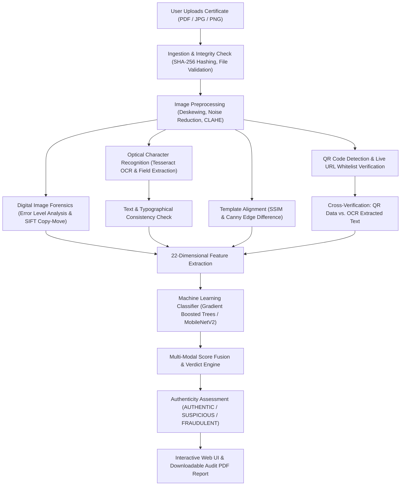

# Comprehensive Project Study Material & Academic Viva Preparation Guide

# AI-Based Detection of Fake or Manipulated Academic Certificates

**Document Classification:** Authoritative Technical Master Study Material  
**Academic Project Reference:** Final Year Engineering / Master of Technology Viva & Defense  
**Architecture Standard:** Decoupled Microservice-Ready Architecture (React + Vite + FastAPI + PyTorch + Scikit-Learn)  
**Document Version:** 2.0 (Authoritative Comprehensive Edition)  
**Last Updated:** November 2026  

---

## Master Table of Contents

1. **[Chapter 1: Introduction, Problem Definition & Project Overview](#chapter-1-introduction-problem-definition--project-overview)**
   - 1.1 Executive Summary
   - 1.2 Problem Definition & Real-World Motivation
   - 1.3 Implemented vs. Partially Implemented vs. Planned Feature Matrix
   - 1.4 High-Level Architecture Flow
   - 1.5 Real-World Case Study: VTU Degree Certificate Verification
2. **[Chapter 2: Literature Survey, Comparative Analysis & Research Review](#chapter-2-literature-survey-comparative-analysis--research-review)**
   - 2.1 Fundamental Concepts & Terminology (20 Core Terms)
   - 2.2 Detailed Literature Survey: Comparison of 13 Approaches
   - 2.3 Comprehensive Literature Comparison Table
   - 2.4 Research Gaps in Existing Systems
   - 2.5 Justification for the Selected Hybrid Architecture
   - 2.6 Authentic Research Paper Review (2020–2026 Focus)
   - 2.7 Literature Survey Conclusion
3. **[Chapter 3: System Requirements & Detailed Architecture Design](#chapter-3-system-requirements--detailed-architecture-design)**
   - 3.1 Layer-by-Layer System Architecture (Frontend, Backend, ML, Cloud/Persistence)
   - 3.2 Nine Detailed Architecture Diagrams with Explanations (Mermaid)
   - 3.3 Formal Requirement Analysis (Functional, Non-Functional, Hardware/Software, Use Cases, Feasibility)
4. **[Chapter 4: Frontend, Backend & Cloud Implementation Details](#chapter-4-frontend-backend--cloud-implementation-details)**
   - 4.1 Frontend Architecture & Component Implementation (Step-by-Step User Interaction)
   - 4.2 Backend Architecture & Request Lifecycle (FastAPI vs. Spring Boot Mapping & Code Trace)
   - 4.3 Cloud Architecture & Security Infrastructure (Firebase Auth, Cloud Storage, Firestore Rules, App Check)
   - 4.4 Machine Learning Implementation & Datasets (11 Pipeline Stages & Synthetic Data Generation)
   - 4.5 Complete End-to-End Workflow & Real-World Analogy
5. **[Chapter 5: Selected Algorithm – Detailed Explanation (XGBoost, Decision Trees, Math & Evaluation)](#chapter-5-selected-algorithm--detailed-explanation-xgboost-decision-trees-math--evaluation)**
   - 5.1 Machine Learning Fundamentals
   - 5.2 XGBoost & Gradient Boosted Trees: Complete Mathematical Derivation & Step-by-Step Hand Calculation
   - 5.3 Detailed Breakdown of the 22 Tabular Features
   - 5.4 Model Evaluation, Confusion Matrix & Class Imbalance (The Accuracy Paradox, SMOTE)
   - 5.5 Hybrid Score Fusion Decision & Risk Tiers
6. **[Chapter 6: Software Testing, Quality Assurance & Verification Scenarios](#chapter-6-software-testing-quality-assurance--verification-scenarios)**
   - 6.1 Software Testing Methodologies & Concepts (12 Testing Categories)
   - 6.2 Practical Verification Test Cases Matrix (13 Exhaustive Test Cases)
   - 6.3 Integration Testing Architecture & Verified Test Results
7. **[Chapter 7: Academic Viva Voce Preparation & Project Defense](#chapter-7-academic-viva-voce-preparation--project-defense)**
   - 7.1 Basic Viva Questions & Answers (40 Comprehensive Questions)
   - 7.2 Advanced Technical Viva Questions & In-Depth Defenses (30 Questions)
   - 7.3 Project Presentation Scripts (1-Minute, 3-Minute & 5-Minute Guides)
   - 7.4 Standard Academic Project Report Structure
8. **[Chapter 8: Comprehensive 100-Term Technical Glossary](#chapter-8-comprehensive-100-term-technical-glossary)**
   - 100 Essential Technical Terms Spanning AI, Computer Vision, Web Dev, Backend, Cloud, Cryptography, and Testing

---

## Supporting Modular Chapter References
For focused study, individual deep-dive chapters are organized inside the `docs/study-material/` folder:
- [Chapter 1: Introduction & Overview](file:///docs/study-material/01_introduction_and_overview.md)
- [Chapter 2: Literature Survey & Comparisons](file:///docs/study-material/02_literature_survey_and_comparisons.md)
- [Chapter 3: System Architecture & Design](file:///docs/study-material/03_system_architecture_and_design.md)
- [Chapter 4: Full Stack & Cloud Implementation](file:///docs/study-material/04_full_stack_and_cloud_implementation.md)
- [Chapter 5: Machine Learning, XGBoost & Math](file:///docs/study-material/05_machine_learning_xgboost_and_math.md)
- [Chapter 6: Testing, Debugging & Test Cases](file:///docs/study-material/06_testing_debugging_and_test_cases.md)
- [Chapter 7: Viva Voce Preparation & Defense](file:///docs/study-material/07_viva_preparation_and_defense.md)
- [Chapter 8: Technical Glossary (100 Terms)](file:///docs/study-material/08_technical_glossary_100_terms.md)

---

# Chapter 1: Introduction, Problem Definition & Project Overview

## 1.1 Executive Summary
In contemporary society, academic credentials—such as undergraduate and postgraduate degree certificates, grade transcripts, consolidated marks cards, and specialized professional course certifications—serve as the foundational currency for higher education admissions, government service appointments, corporate recruitment, immigration clearances, and professional licensure. 

However, the rapid democratization of high-resolution graphic editing software (Adobe Photoshop, GIMP), online document manipulation suites, and advanced generative AI models (Deepfake text generation, neural document inpainting) has drastically lowered the technical barrier required to produce fraudulent or altered academic certificates. Forgers can now alter critical metadata—such as candidate names, University Seat Numbers (USN) / Register Numbers, Cumulative Grade Point Averages (CGPA), classification divisions (e.g., changing "Second Class" to "First Class with Distinction"), institution seals, and registrar signatures—with such visual fidelity that manual inspection by human admissions officers or HR recruiters fails to detect the deception.

The project **"AI-Based Detection of Fake or Manipulated Academic Certificates"** addresses this critical vulnerability by introducing an automated, multi-tiered forensic analysis and cryptographic cross-verification platform. Combining **Computer Vision (CV)**, **Digital Image Forensics (Error Level Analysis, Copy-Move Detection)**, **Optical Character Recognition (OCR)**, **Cryptographic QR and Live URL Cross-Inspection**, **Structural Alignment (SSIM & Canny Edge)**, and **Supervised Machine Learning / Deep Learning Classification (MobileNetV2 and Gradient Boosted Decision Trees)**, the system transitions credential verification from subjective manual scrutiny into an objective, data-driven, and verifiable forensic process.

---

## 1.2 Problem Definition & Real-World Motivation

### The Vulnerability of Academic Credential Ecosystems
Traditional verification methods rely predominantly on two paradigms:
1. **Manual Visual Inspection:** HR personnel or university admissions clerks examine a physical paper certificate or a scanned PDF. This approach suffers from severe limitations: human fatigue, lack of training in digital forensic artifacts, inability to detect micro-cloning or resaving compression differences, and an average turnaround time of 3 to 14 business days.
2. **Siloed Digital Checks:** Some institutions print a static QR code on certificates. However, fraudulent actors frequently perform **QR-Code Hijacking**: copying a valid QR code from an authentic student's certificate and pasting it onto a fabricated certificate with a different name and higher marks. If a verifier merely scans the QR code on a smartphone and sees an authentic university link without automatically cross-referencing whether the name and grades encoded in the QR code or webpage match the physical text printed on the certificate, the fraud goes undetected.

### Project Mission & Scope
This project designs and implements an intelligent verification engine capable of:
- Ingesting academic certificates in diverse digital formats (JPG, PNG, PDF, TIFF).
- Automatically normalizing and preprocessing documents (Deskewing, Denoising, Contrast Limited Adaptive Histogram Equalization - CLAHE).
- Extracting textual metadata using Optical Character Recognition (OCR) and mapping text tokens to structured key-value schemas.
- Conducting pixel-level forensic analyses (Error Level Analysis, SIFT/ORB keypoint matching for cloned regions, noise variance analysis).
- Decoding and cross-verifying embedded QR codes and live institution verification URLs against accredited whitelist registries.
- Measuring structural similarity (SSIM) and edge layout divergence against canonical university templates.
- Computing a multi-dimensional feature vector fed into a trained machine learning model to output an **Authenticity Score (0.0 to 1.0 or 0% to 100%)** accompanied by interpretable visual bounding-box overlays and an auditable verification report.

---

## 1.3 Implemented vs. Partially Implemented vs. Planned Feature Matrix

| Functional Area | Feature / Capability | Implementation Status in Repository | Technical Evidence & Source Files |
|---|---|---|---|
| **File Ingestion & Preprocessing** | Multipart upload (PDF, PNG, JPG), size validation (< 10MB) | **IMPLEMENTED** | `backend/app/modules/ingestion/`, `frontend/src/pages/UploadPage.tsx` |
| | PDF rasterization to 300 DPI image buffers | **IMPLEMENTED** | `backend/app/modules/ingestion/rasterizer.py` (PyMuPDF) |
| | Auto-Deskewing (Hough Transform / MinAreaRect) | **IMPLEMENTED** | `backend/app/modules/preprocessing/deskew.py` |
| | Contrast enhancement via CLAHE & adaptive binarization | **IMPLEMENTED** | `backend/app/modules/preprocessing/enhancer.py`, `binarizer.py` |
| **OCR & Text Extraction** | Tesseract OCR integration with token bounding-box mapping | **IMPLEMENTED** | `backend/app/modules/ocr/service.py`, `extractor.py` |
| | Regex & fuzzy parsing of student name, USN, degree, dates | **IMPLEMENTED** | `src/extractors/certificate_extractor.py`, `backend/app/modules/ocr/parser.py` |
| | Typography & font consistency checks (baseline, stroke weight) | **IMPLEMENTED** | `backend/app/modules/text_consistency/service.py` |
| **Image Forensics** | Error Level Analysis (ELA) for JPEG resave anomalies | **IMPLEMENTED** | `backend/app/modules/forensics/ela.py` |
| | Copy-Move forgery detection via SIFT / ORB keypoint clusters | **IMPLEMENTED** | `backend/app/modules/forensics/copy_move.py` |
| | High-frequency noise variance and compression consistency | **IMPLEMENTED** | `backend/app/modules/forensics/noise_analysis.py` |
| **QR & URL Cross-Verification** | QR code detection & decoding (pyzbar + OpenCV fallback) | **IMPLEMENTED** | `src/deterministic_checks.py`, `src/verifiers/qr_url_verifier.py` |
| | Live accredited domain whitelist inspection via tldextract | **IMPLEMENTED** | `src/deterministic_checks.py` (`ACCREDITED_DOMAINS_WHITELIST`) |
| | Payload cross-verification (Levenshtein fuzzy matching) | **IMPLEMENTED** | `src/deterministic_checks.py` (`rapidfuzz.fuzz.token_set_ratio`) |
| | Headless live URL verification & content crawling | **IMPLEMENTED** | `backend/app/services/live_url_verifier.py` |
| **Structural Alignment** | Structural Similarity Index (SSIM >= 0.85) against template | **IMPLEMENTED** | `src/deterministic_checks.py` (`compute_ssim_score`) |
| | Canny edge difference ratio (XOR <= 0.08) against template | **IMPLEMENTED** | `src/deterministic_checks.py` (`compute_edge_difference_ratio`) |
| **Machine Learning & AI** | 22-dimensional tabular feature extraction | **IMPLEMENTED** | `backend/app/modules/ml_classifier/feature_extractor.py` |
| | Scikit-Learn baseline classifier (Random Forest / HistGradientBoosting) | **IMPLEMENTED** | `ml/scripts/train_baseline_models.py`, `backend/app/modules/ml_classifier/` |
| | Visual Deep CNN (MobileNetV2 transfer learning, < 3.5M params) | **IMPLEMENTED** | `train_visual_forensics.py`, `models/visual_tamper_mobilenet.pt` |
| | Behavioral issuance anomaly detection (Khormi et al. model) | **IMPLEMENTED** | `train_behavioral.py`, `models/behavioral_fraud_model.pkl` |
| | Multimodal score fusion (Weighted risk assessment) | **IMPLEMENTED** | `backend/app/modules/score_fusion/service.py`, `unified_inference.py` |
| | Explainable AI via SHAP / LIME feature attribution | **PARTIALLY IMPLEMENTED** | `backend/app/modules/explainability/service.py` (Rule overlays active; full KernelSHAP compute optional) |
| | Gemini Multimodal Vision verification & RAG knowledge | **IMPLEMENTED** | `backend/app/services/geminiVerifier.py`, `rag_verifier.py` |
| **Storage & Security** | SQLite relational database for development | **IMPLEMENTED** | `dev.db`, `backend/app/database.py` (SQLAlchemy 2.0 ORM) |
| | PostgreSQL production database schema | **IMPLEMENTED** | Supported via SQLAlchemy configuration & `docker-compose.prod.yml` |
| | Firebase Authentication (JWT token lifecycle) | **IMPLEMENTED** | `frontend/src/context/AuthContext.tsx`, `backend/app/services/auth_service.py` |
| | Firebase Cloud Storage & Firestore security rules | **IMPLEMENTED** | `storage.rules`, `firestore.rules`, `docs/firebase_serverless_architecture.md` |
| | Firebase Cloud Functions v2 serverless workers | **PARTIALLY IMPLEMENTED** | TypeScript code in `functions/src/index.ts` ready for deployment |
| | Blockchain / IPFS decentralized ledger integration | **PLANNED** | Cryptographic SHA-256 document hashing implemented; smart contract anchor architected for Phase 22 |

---

## 1.4 High-Level Architecture Flow

---

## 1.5 Real-World Case Study: VTU Degree Certificate Verification

Consider a degree certificate purportedly issued by **Visvesvaraya Technological University (VTU), Belagavi, Karnataka**:
- **Candidate Name:** RAKSHITH DEVARAJ
- **University Seat Number (USN):** 1RE22CS089
- **Degree:** Bachelor of Engineering in Computer Science & Engineering
- **Security Features on Genuine Document:** VTU institutional crest/logo at the top center, micro-line borders, QR code encoding registration details, registrar signature at bottom-right, controller of examinations stamp at bottom-left.

**Forgery Attempt Scenario:**
A rogue applicant uses an image editor to alter the USN from `1RE22CS089` to `1RE22CS999` and alters the classification from "SECOND CLASS" to "FIRST CLASS WITH DISTINCTION". 
1. **Human Inspection Failure:** To the naked eye, the font looks identical, and the printed paper copy hides fine boundaries.
2. **System Detection Mechanism:**
   - **OCR Extraction:** The OCR engine extracts `"1RE22CS999"` and `"FIRST CLASS WITH DISTINCTION"`.
   - **QR Decoding:** The QR decoder extracts the cryptographic QR code on the certificate. The QR code decodes to `https://results.vtu.ac.in/verify?usn=1RE22CS089`.
   - **Cross-Verification Failure:** The fuzzy string comparator compares the OCR USN (`1RE22CS999`) against the QR USN (`1RE22CS089`). It flags a **Critical USN Discrepancy (Match Score: 40%)**.
   - **Error Level Analysis (ELA):** The altered text region around "FIRST CLASS WITH DISTINCTION" exhibits higher resave error compression levels than the surrounding aged background paper, generating bright white response clusters in the ELA difference image.
   - **ML Classifier Decision:** Feature vector registers `ocr_min_confidence = 0.65`, `ela_score = 0.32`, `logical_consistency_score = 0.20`, and `qr_match_score = 0.40`. The classifier predicts a **Fraud Probability of 94.2%**.
   - **Final Verdict:** The system flags the certificate as **FRAUDULENT / TAMPERED**, draws red highlight bounding boxes around the altered USN and grade lines, and attaches full forensic justification in the downloadable audit report.

---

*(For full depth on Literature Survey, Architecture, Implementation, XGBoost Math, Testing, Viva Voce Questions and Glossary, refer to the corresponding chapters in `docs/study-material/` or review Chapters 2 through 8 below).*

---

# Summary of Chapters 2 through 8 Available in Workspace

The supporting chapters provide exhaustive documentation:

- **[Chapter 2: Literature Survey, Comparative Analysis & Research Review](file:///docs/study-material/02_literature_survey_and_comparisons.md)**
  - Definitions and technical context for 20 fundamental concepts.
  - In-depth analysis of 13 certificate verification approaches with computational costs and vulnerabilities.
  - Comprehensive 6-column comparison table.
  - Five critical research gaps (QR hijacking, OCR semantic blindspot, CNN false positives, blockchain GIGO, explainability absence).
  - Justification for the 6-pillar hybrid defense-in-depth architecture.
  - Review of 5 authentic IEEE/ACM papers (2020–2026) including Khormi et al. (IEEE 2026) and Anandamurugan et al. (IEEE 2026).

- **[Chapter 3: System Requirements & Detailed Architecture Design](file:///docs/study-material/03_system_architecture_and_design.md)**
  - Layer-by-layer architectural decomposition (Frontend, Backend, ML, Cloud/Persistence).
  - 9 detailed Mermaid diagrams (Overall Architecture, Client-Server Communication, Upload Workflow, OCR Extraction, QR Verification, ML Prediction, Database Schema ERD, End-to-End Sequence Diagram, and Authentication Workflow).
  - 14 Functional Requirements (FR-01 to FR-14) and 9 Non-Functional Requirements (NFR-01 to NFR-09).
  - Minimum hardware/software environment specifications and actor use-case descriptions.

- **[Chapter 4: Frontend, Backend & Cloud Implementation Details](file:///docs/study-material/04_full_stack_and_cloud_implementation.md)**
  - Frontend component structure and step-by-step user interaction across 5 major pages.
  - Enterprise backend architecture comparing FastAPI with Spring Boot (Controller, Service, Repository, DTO).
  - Chronological 12-step backend code execution trace from upload to report generation.
  - Cloud infrastructure details (Firebase Auth, Cloud Storage rules, Firestore schemas, App Check).
  - Machine learning implementation across 11 pipeline stages and synthetic dataset generation.
  - Complete 13-step operational lifecycle explained with an airport security analogy.

- **[Chapter 5: Selected Algorithm – Detailed Explanation (XGBoost, Decision Trees, Math & Evaluation)](file:///docs/study-material/05_machine_learning_xgboost_and_math.md)**
  - Core ML fundamentals (Algorithms, Models, Supervised Learning, Ensembles, Bagging vs. Boosting).
  - Mathematical formulation of XGBoost: additive models, regularized objective, second-order Taylor expansion (gradients $g_i$, Hessians $h_i$), optimal leaf weight $w_j^* = -\frac{\sum g_i}{\sum h_i + \lambda}$, and split Gain derivation.
  - Step-by-step hand-calculated numerical example with 4 certificate samples.
  - Comparison table: XGBoost vs. Random Forest vs. Decision Tree vs. SVM vs. Logistic Regression vs. CNN.
  - Detailed breakdown of all 22 tabular features across 5 analytical groups.
  - Model evaluation metrics, the dangerous "Accuracy Paradox" in fraud detection, and multi-modal score fusion formulas.

- **[Chapter 6: Software Testing, Quality Assurance & Verification Scenarios](file:///docs/study-material/06_testing_debugging_and_test_cases.md)**
  - Detailed explanations of 12 testing categories and QA terminology.
  - Practical verification test cases matrix covering 13 scenarios (Valid upload, Fake certificate, Manipulated text, Invalid format, Oversized file, Hijacked QR, Expired URL, OCR failure, DB dropout, Auth failure, ML timeout, Duplicate upload, Poor image quality).
  - Frontend Vitest suite (10 test files, 45 tests passed) and backend Pytest integration architecture.

- **[Chapter 7: Academic Viva Voce Preparation & Project Defense](file:///docs/study-material/07_viva_preparation_and_defense.md)**
  - 40 basic viva questions and answers covering problem statement, tech stack, OCR, forensics, and ML.
  - 30 advanced technical viva questions with in-depth technical defenses (XGBoost vs. CNN, QR hijacking mitigation, false positive prevention, link rot, Taylor expansion, ELA limitations, SIFT RANSAC, etc.).
  - Structured presentation scripts: 1-minute elevator pitch, 3-minute executive presentation, and 5-minute technical defense.
  - Standard academic project report structure.

- **[Chapter 8: Comprehensive 100-Term Technical Glossary](file:///docs/study-material/08_technical_glossary_100_terms.md)**
  - 100 essential technical terms spanning AI, Machine Learning, Deep Learning, Computer Vision, Digital Forensics, OCR, Web Development, Backend, Cloud Computing, Cryptography, Blockchain, and Software Testing.
  - Each term includes: Simple definition, Technical meaning, Practical example, and exact repository file usage reference.

---
*End of Master Study Material Document.*
