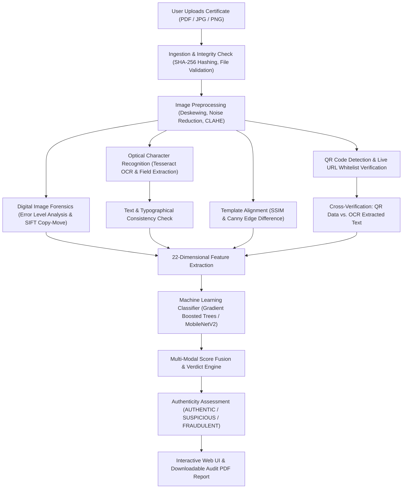

# Chapter 1: Introduction, Problem Definition & Project Overview

## 1.1 Executive Summary

In contemporary society, academic credentials—such as undergraduate and postgraduate degree certificates, grade transcripts, consolidated marks cards, and specialized professional course certifications—serve as the foundational currency for higher education admissions, government service appointments, corporate recruitment, immigration clearances, and professional licensure. 

However, the rapid democratization of high-resolution graphic editing software (Adobe Photoshop, GIMP), online document manipulation suites, and advanced generative AI models (Deepfake text generation, neural document inpainting) has drastically lowered the technical barrier required to produce fraudulent or altered academic certificates. Forgers can now alter critical metadata—such as candidate names, University Seat Numbers (USN) / Register Numbers, Cumulative Grade Point Averages (CGPA), classification divisions (e.g., changing "Second Class" to "First Class with Distinction"), institution seals, and registrar signatures—with such visual fidelity that manual inspection by human admissions officers or HR recruiters fails to detect the deception.

The project **"AI-Based Detection of Fake or Manipulated Academic Certificates"** addresses this critical vulnerability by introducing an automated, multi-tiered forensic analysis and cryptographic cross-verification platform. Combining **Computer Vision (CV)**, **Digital Image Forensics (Error Level Analysis, Copy-Move Detection)**, **Optical Character Recognition (OCR)**, **Cryptographic QR and Live URL Cross-Inspection**, **Structural Alignment (SSIM & Canny Edge)**, and **Supervised Machine Learning / Deep Learning Classification (MobileNetV2 and Gradient Boosted Decision Trees)**, the system transitions credential verification from subjective manual scrutiny into an objective, data-driven, and verifiable forensic process.

---

## 1.2 Problem Definition & Real-World Motivation

### The Vulnerability of Academic Credential Ecosystems
Traditional verification methods rely predominantly on two paradigms:
1. **Manual Visual Inspection:** HR personnel or university admissions clerks examine a physical paper certificate or a scanned PDF. This approach suffers from severe limitations: human fatigue, lack of training in digital forensic artifacts, inability to detect micro-cloning or resaving compression differences, and an average turnaround time of 3 to 14 business days.
2. **Siloed Digital Checks:** Some institutions print a static QR code on certificates. However, fraudulent actors frequently perform **QR-Code Hijacking**: copying a valid QR code from an authentic student's certificate and pasting it onto a fabricated certificate with a different name and higher marks. If a verifier merely scans the QR code on a smartphone and sees an authentic university link without automatically cross-referencing whether the name and grades encoded in the QR code or webpage match the physical text printed on the certificate, the fraud goes undetected.

### Project Mission & Scope
This project designs and implements an intelligent verification engine capable of:
- Ingesting academic certificates in diverse digital formats (JPG, PNG, PDF, TIFF).
- Automatically normalizing and preprocessing documents (Deskewing, Denoising, Contrast Limited Adaptive Histogram Equalization - CLAHE).
- Extracting textual metadata using Optical Character Recognition (OCR) and mapping text tokens to structured key-value schemas.
- Conducting pixel-level forensic analyses (Error Level Analysis, SIFT/ORB keypoint matching for cloned regions, noise variance analysis).
- Decoding and cross-verifying embedded QR codes and live institution verification URLs against accredited whitelist registries.
- Measuring structural similarity (SSIM) and edge layout divergence against canonical university templates.
- Computing a multi-dimensional feature vector fed into a trained machine learning model to output an **Authenticity Score (0.0 to 1.0 or 0% to 100%)** accompanied by interpretable visual bounding-box overlays and an auditable verification report.

---

## 1.3 Implemented vs. Partially Implemented vs. Planned Feature Matrix

To maintain strict academic integrity during project evaluation and viva defense, the table below provides a factual classification of all system capabilities:

| Functional Area | Feature / Capability | Implementation Status in Repository | Technical Evidence & Source Files |
|---|---|---|---|
| **File Ingestion & Preprocessing** | Multipart upload (PDF, PNG, JPG), size validation (< 10MB) | **IMPLEMENTED** | `backend/app/modules/ingestion/`, `frontend/src/pages/UploadPage.tsx` |
| | PDF rasterization to 300 DPI image buffers | **IMPLEMENTED** | `backend/app/modules/ingestion/rasterizer.py` (PyMuPDF / pdf2image) |
| | Auto-Deskewing (Hough Transform / MinAreaRect) | **IMPLEMENTED** | `backend/app/modules/preprocessing/deskew.py` |
| | Contrast enhancement via CLAHE & adaptive binarization | **IMPLEMENTED** | `backend/app/modules/preprocessing/enhancer.py`, `binarizer.py` |
| **OCR & Text Extraction** | Tesseract OCR integration with token bounding-box mapping | **IMPLEMENTED** | `backend/app/modules/ocr/service.py`, `extractor.py` |
| | Regex & fuzzy parsing of student name, USN, degree, dates | **IMPLEMENTED** | `src/extractors/certificate_extractor.py`, `backend/app/modules/ocr/parser.py` |
| | Typography & font consistency checks (baseline, stroke width) | **IMPLEMENTED** | `backend/app/modules/text_consistency/service.py` |
| **Image Forensics** | Error Level Analysis (ELA) for JPEG resave anomalies | **IMPLEMENTED** | `backend/app/modules/forensics/ela.py` |
| | Copy-Move forgery detection via SIFT / ORB keypoint clusters | **IMPLEMENTED** | `backend/app/modules/forensics/copy_move.py` |
| | High-frequency noise variance and compression consistency | **IMPLEMENTED** | `backend/app/modules/forensics/noise_analysis.py` |
| **QR & URL Cross-Verification** | QR code detection & decoding (pyzbar + OpenCV fallback) | **IMPLEMENTED** | `src/deterministic_checks.py`, `src/verifiers/qr_url_verifier.py` |
| | Live accredited domain whitelist inspection via tldextract | **IMPLEMENTED** | `src/deterministic_checks.py` (`ACCREDITED_DOMAINS_WHITELIST`) |
| | Payload cross-verification (Levenshtein fuzzy matching) | **IMPLEMENTED** | `src/deterministic_checks.py` (`rapidfuzz.fuzz.token_set_ratio`) |
| | Headless live URL verification & content crawling | **IMPLEMENTED** | `backend/app/services/live_url_verifier.py` |
| **Structural Alignment** | Structural Similarity Index (SSIM >= 0.85) against template | **IMPLEMENTED** | `src/deterministic_checks.py` (`compute_ssim_score`) |
| | Canny edge difference ratio (XOR <= 0.08) against template | **IMPLEMENTED** | `src/deterministic_checks.py` (`compute_edge_difference_ratio`) |
| **Machine Learning & AI** | 22-dimensional tabular feature extraction | **IMPLEMENTED** | `backend/app/modules/ml_classifier/feature_extractor.py` |
| | Scikit-Learn baseline classifier (Random Forest / HistGradientBoosting) | **IMPLEMENTED** | `ml/scripts/train_baseline_models.py`, `backend/app/modules/ml_classifier/` |
| | Visual Deep CNN (MobileNetV2 transfer learning, < 3.5M params) | **IMPLEMENTED** | `train_visual_forensics.py`, `models/visual_tamper_mobilenet.pt` |
| | Behavioral issuance anomaly detection (Khormi et al. model) | **IMPLEMENTED** | `train_behavioral.py`, `models/behavioral_fraud_model.pkl` |
| | Multimodal score fusion (Weighted risk assessment) | **IMPLEMENTED** | `backend/app/modules/score_fusion/service.py`, `unified_inference.py` |
| | Explainable AI via SHAP / LIME feature attribution | **PARTIALLY IMPLEMENTED** | `backend/app/modules/explainability/service.py` (Rule & weight based overlays active; full KernelSHAP background compute optional) |
| | Gemini Multimodal Vision verification & RAG knowledge | **IMPLEMENTED** | `backend/app/services/geminiVerifier.py`, `rag_verifier.py` |
| **Storage & Security** | SQLite relational database for development | **IMPLEMENTED** | `dev.db`, `backend/app/database.py` (SQLAlchemy 2.0 ORM) |
| | PostgreSQL production database schema | **IMPLEMENTED** | Supported via SQLAlchemy configuration & `docker-compose.prod.yml` |
| | Firebase Authentication (JWT token lifecycle) | **IMPLEMENTED** | `frontend/src/context/AuthContext.tsx`, `backend/app/services/auth_service.py` |
| | Firebase Cloud Storage & Firestore security rules | **IMPLEMENTED** | `storage.rules`, `firestore.rules`, `docs/firebase_serverless_architecture.md` |
| | Firebase Cloud Functions v2 serverless workers | **PARTIALLY IMPLEMENTED** | TypeScript code in `functions/src/index.ts` ready for Firebase deployment |
| | Blockchain / IPFS decentralized ledger integration | **PLANNED** | Cryptographic SHA-256 document hashing is implemented; on-chain smart contract anchor is architected for Phase 22 |

---

## 1.4 High-Level Architecture Flow

The complete end-to-end operational flow follows a disciplined sequence:

---

## 1.5 Real-World Case Study: VTU Degree Certificate Verification

To ground this technical architecture in a practical scenario, consider a degree certificate purportedly issued by **Visvesvaraya Technological University (VTU), Belagavi, Karnataka**:
- **Candidate Name:** RAKSHITH DEVARAJ
- **University Seat Number (USN):** 1RE22CS089
- **Degree:** Bachelor of Engineering in Computer Science & Engineering
- **Security Features on Genuine Document:** VTU institutional crest/logo at the top center, micro-line borders, QR code encoding registration details, registrar signature at bottom-right, controller of examinations stamp at bottom-left.

**Forgery Attempt Scenario:**
A rogue applicant uses an image editor to alter the USN from `1RE22CS089` to `1RE22CS999` and alters the classification from "SECOND CLASS" to "FIRST CLASS WITH DISTINCTION". 
1. **Human Inspection Failure:** To the naked eye, the font looks identical, and the printed paper copy hides fine boundaries.
2. **System Detection Mechanism:**
   - **OCR Extraction:** The OCR engine extracts `"1RE22CS999"` and `"FIRST CLASS WITH DISTINCTION"`.
   - **QR Decoding:** The QR decoder extracts the cryptographic QR code on the certificate. The QR code decodes to `https://results.vtu.ac.in/verify?usn=1RE22CS089`.
   - **Cross-Verification Failure:** The fuzzy string comparator compares the OCR USN (`1RE22CS999`) against the QR USN (`1RE22CS089`). It flags a **Critical USN Discrepancy (Match Score: 40%)**.
   - **Error Level Analysis (ELA):** The altered text region around "FIRST CLASS WITH DISTINCTION" exhibits higher resave error compression levels than the surrounding aged background paper, generating bright white response clusters in the ELA difference image.
   - **ML Classifier Decision:** Feature vector registers `ocr_min_confidence = 0.65`, `ela_score = 0.32`, `logical_consistency_score = 0.20`, and `qr_match_score = 0.40`. The classifier predicts a **Fraud Probability of 94.2%**.
   - **Final Verdict:** The system flags the certificate as **FRAUDULENT / TAMPERED**, draws red highlight bounding boxes around the altered USN and grade lines, and attaches full forensic justification in the downloadable audit report.
