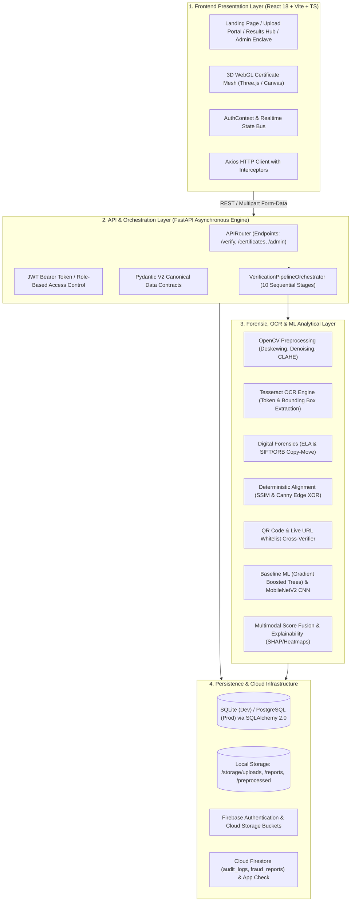
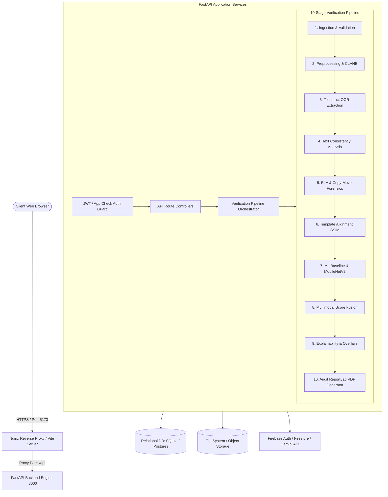
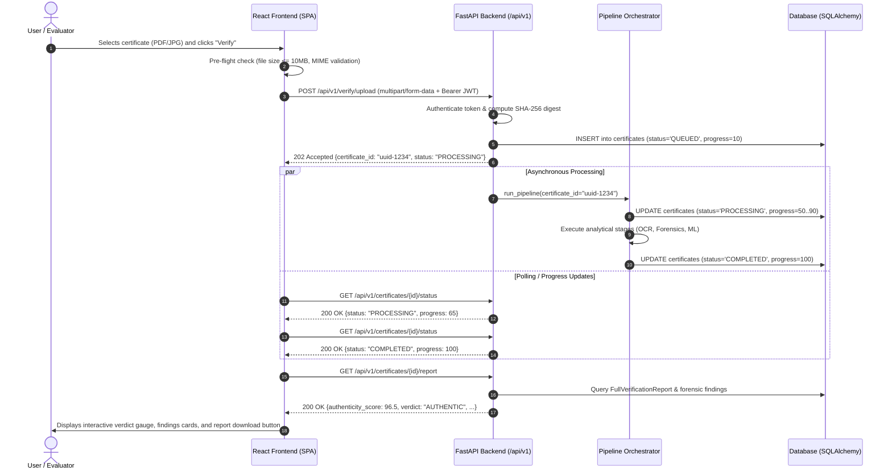
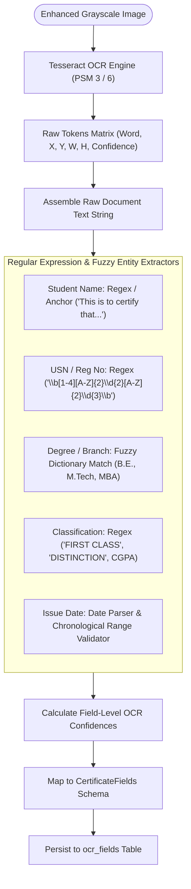
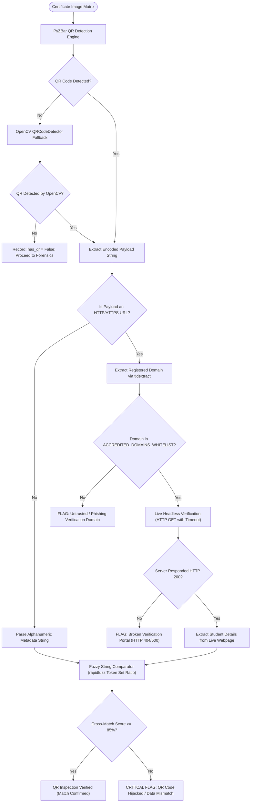
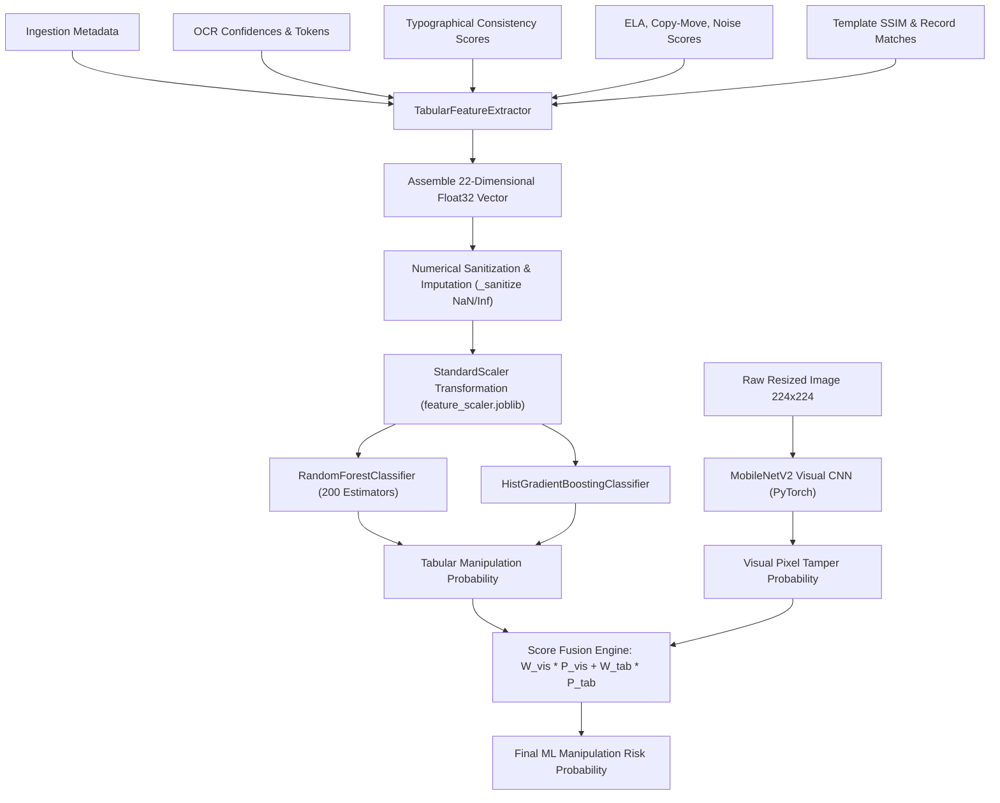
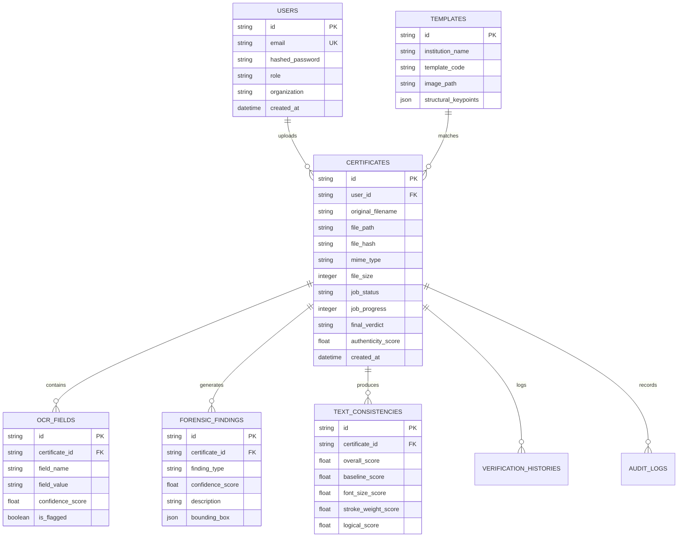
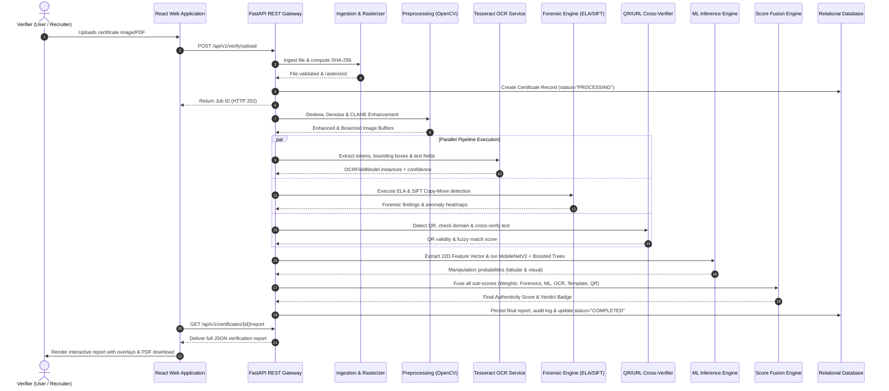
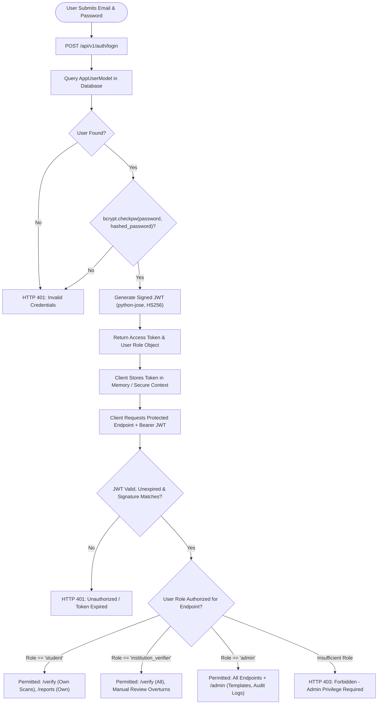

# Chapter 3: System Requirements & Detailed Architecture Design

## 3.1 Layer-by-Layer System Architecture

The platform is designed following a **decoupled, multi-tiered micro-service ready architecture**. This separation of concerns ensures that the user interface, API orchestration, compute-heavy computer vision tasks, and persistence layers remain modular, scalable, and testable.



---

### A. Frontend Presentation Layer
* **Technologies:** React 18, TypeScript 5.2, Vite 5.4, TailwindCSS 3.4, Lucide React icons, Three.js WebGL canvas.
* **Responsibilities:**
  - Provides a responsive, accessible single-page application (SPA) optimized for desktop, tablet, and mobile browsers.
  - Implements client-side pre-flight validation (file size $\le 10\text{ MB}$, MIME type checking for PDF, PNG, JPG).
  - Features an interactive 3D WebGL certificate viewer displaying simulated security watermarks, UV seals, and holographic foils.
  - Manages client-side routing via `React Router DOM v6`, isolating public landing views from protected verifier workspaces.
  - Renders forensic bounding-box overlays and tampering heatmaps directly on top of certificate previews.

---

### B. Backend API & Orchestration Layer
* **Technologies:** Python 3.11+, FastAPI 0.110+, Uvicorn ASGI, Pydantic V2, SQLAlchemy 2.0 ORM.
* **Responsibilities:**
  - Exposes high-throughput asynchronous RESTful API endpoints adhering to OpenAPI 3.1 specifications.
  - Enforces Role-Based Access Control (RBAC) across three distinct user personas: `student`, `institution_verifier`, and `admin`.
  - Implements `VerificationPipelineOrchestrator` (`backend/app/services/pipeline_orchestrator.py`), which executes 10 sequential analytical stages with stage-level timeout isolation and graceful degradation.
* *Enterprise Framework Note:* While implemented in Python FastAPI to achieve seamless zero-copy interoperability with native C++ machine learning and computer vision libraries (OpenCV, PyTorch, Scikit-Learn), the backend strictly follows the **Controller-Service-Repository-DTO** pattern standardized in enterprise Spring Boot architectures:
  - *Routers / Endpoints* act as Spring Boot `@RestController` classes.
  - *Pipeline Services* encapsulate business logic identical to `@Service` components.
  - *SQLAlchemy Models & Queries* perform the role of `@Repository` / Spring Data JPA interfaces.
  - *Pydantic V2 Schemas* act as immutable Data Transfer Objects (DTOs) with field validation.

---

### C. Forensic, Computer Vision & Machine Learning Layer
* **Technologies:** OpenCV (`opencv-python-headless`), NumPy, SciPy, scikit-image, Pillow, Tesseract OCR (`pytesseract`), PyZBar, PyTorch, Torchvision (MobileNetV2), Scikit-Learn, Joblib, RapidFuzz.
* **Responsibilities:**
  - Rasterizes multi-page PDF documents into 300 DPI high-resolution image matrices.
  - Automatically corrects perspective distortions and skew angles using the Radon/Hough Transform.
  - Extracts alphanumeric text tokens, token coordinates, and field confidences.
  - Detects physical and compression tampering using Error Level Analysis (ELA) and SIFT/ORB keypoint clustering.
  - Computes Structural Similarity Index (SSIM) and Canny edge difference ratios against authoritative templates.
  - Extracts 22 standardized tabular features fed into gradient-boosted decision tree ensembles and MobileNetV2 CNNs.
  - Generates an auditable, weighted authenticity score $(0 - 100\%)$ with granular category sub-scores.

---

### D. Cloud, Security & Persistence Layer
* **Technologies:** SQLAlchemy 2.0, SQLite (development `dev.db`), PostgreSQL (production containerized), Firebase Authentication, Firebase Cloud Storage, Cloud Firestore, Firebase App Check (reCAPTCHA Enterprise), SHA-256.
* **Responsibilities:**
  - Computes hex-encoded SHA-256 checksums upon file ingestion to guarantee tamper-evident traceability.
  - Stores relational metadata (user accounts, verification job statuses, extracted OCR fields, forensic findings, audit logs) in relational tables.
  - Stores binary certificate assets, preprocessed intermediate images, and generated PDF reports in structured directories (`storage/uploads/`, `storage/reports/`).
  - Supports serverless cloud operations via Cloud Firestore rules, Firebase Storage rules, and Node.js 20 Cloud Functions v2.

---

## 3.2 Nine Detailed Architecture Diagrams with Technical Explanations

### Diagram 1: Overall System Architecture
Shows how client requests traverse the reverse proxy, API gateway, pipeline orchestrator, analytical modules, and persistent storage.


*Explanation:* The client interacts with the React SPA. API calls route to the FastAPI backend, where incoming tokens and schemas are validated before being handed to the 10-stage sequential pipeline orchestrator. Results are committed to the database and file storage.

---

### Diagram 2: Frontend-Backend Communication Flow
Illustrates the RESTful contract, multipart form upload, and state machine lifecycle.


*Explanation:* Shows how the frontend performs pre-flight client validation, submits a multipart upload, receives an immediate asynchronous job ticket, tracks progress, and retrieves the complete forensic report upon completion.

---

### Diagram 3: Certificate Upload & Pre-Flight Validation Workflow
Examines the physical file validation, security sanity checks, and rasterization pipeline.

```mermaid
flowchart TD
    Start([Upload Initiated]) --> ExtCheck{"Extension in [.pdf, .png, .jpg, .jpeg, .tiff]?"}
    ExtCheck -- No --> RejectFormat[Reject: HTTP 415 Unsupported Media Type]
    ExtCheck -- Yes --> SizeCheck{"File Size <= 10,485,760 Bytes (10MB)?"}
    SizeCheck -- No --> RejectSize[Reject: HTTP 413 Payload Too Large]
    SizeCheck -- Yes --> MagicBytes{"Magic Bytes Match Expected MIME Type?"}
    MagicBytes -- No --> RejectMime[Reject: HTTP 422 Invalid Document Signature]
    MagicBytes -- Yes --> Checksum[Compute Hex SHA-256 Digest]
    Checksum --> DupeCheck{"Digest Exists in Database?"}
    DupeCheck -- Yes --> FlagDupe[Log Duplicate Submission / Fetch Cached Verdict]
    DupeCheck -- No --> SaveDisk[Persist File to /storage/uploads/{id}]
    SaveDisk --> IsPDF{"Is Document a PDF?"}
    IsPDF -- Yes --> Rasterize[Rasterize Page 1 via PyMuPDF at 300 DPI to PNG]
    IsPDF -- No --> LoadImage[Load Image Matrix into NumPy Array]
    Rasterize --> LoadImage
    LoadImage --> PipelineHandoff([Handoff to Image Preprocessing])
```
*Explanation:* Protects the backend against malicious payload injection by inspecting file extensions, size limits, and true magic byte headers before computing the SHA-256 checksum and rasterizing PDF files to standard 300 DPI image buffers.

---

### Diagram 4: Optical Character Recognition (OCR) & Field Parsing Workflow
Traces the extraction of textual tokens and regex-based entity recognition.


*Explanation:* Shows how Tesseract extracts spatial tokens and bounding boxes, which are parsed by deterministic regex engines into structured fields (`student_name`, `register_number`, `course_degree`, `grade_or_marks`, `issue_date`).

---

### Diagram 5: QR-Code & Live URL Verification Workflow
Details the detection of 2D barcodes, whitelist extraction, and text cross-referencing.


*Explanation:* Demonstrates how QR codes are detected and decoded, checked against an educational domain whitelist (`ACCREDITED_DOMAINS_WHITELIST`), and cross-verified against OCR text using fuzzy token matching to expose QR-swapping fraud.

---

### Diagram 6: Machine Learning Prediction Workflow
Shows the assembly of the 22-dimensional feature vector, scaling, and ensemble inference.


*Explanation:* The feature extractor gathers 22 scalar metrics across 5 upstream modules, sanitizes them against $NaN$ and infinity, applies standard scaling, and executes dual inference across gradient-boosted decision trees and a lightweight MobileNetV2 CNN.

---

### Diagram 7: Database & Cloud Storage Architecture
Illustrates the relational schema, foreign key constraints, and storage partitions.


*Explanation:* Documents the relational database design implemented via SQLAlchemy 2.0 ORM, showing foreign key cascades linking certificates to their corresponding OCR fields, forensic findings, consistency scores, and audit records.

---

### Diagram 8: Complete End-to-End Certificate Verification Sequence
Chronological interaction across all system actors and components.


*Explanation:* Comprehensive sequence showing asynchronous job creation, parallel execution of OCR, forensics, and QR analysis, followed by ML feature extraction, score fusion, database commit, and client rendering.

---

### Diagram 9: Authentication & Authorization Workflow
Details the security perimeter, JWT lifecycle, and role separation.


*Explanation:* Illustrates the stateless JWT security model utilizing bcrypt password hashing and cryptographic signature validation, enforcing strict role-based authorization across student, verifier, and admin users.

---

## 3.3 Formal Requirement Analysis

### Functional Requirements (FR)
* **FR-01 (Authentication & RBAC):** The system shall authenticate users via cryptographically signed JWT tokens and enforce role segregation (`student`, `institution_verifier`, `admin`).
* **FR-02 (Multi-Format Ingestion):** The system shall accept certificate uploads in PDF, PNG, JPG, JPEG, and TIFF formats up to a maximum size of 10 MB.
* **FR-03 (Automated Preprocessing):** The system shall deskew images to within $\pm 0.5^\circ$ of horizontal alignment and apply CLAHE contrast enhancement.
* **FR-04 (OCR Extraction):** The system shall extract text tokens, bounding box coordinates, and token confidences using Tesseract OCR.
* **FR-05 (Structured Field Parsing):** The system shall parse candidate name, registration number/USN, institution name, course/degree, grade/marks, and issue date into canonical Pydantic schemas.
* **FR-06 (Typographical Consistency):** The system shall evaluate baseline alignment, font size variation, stroke weight, and character spacing to detect spliced text.
* **FR-07 (Error Level Analysis):** The system shall compute an ELA difference image to identify localized compression anomalies resulting from secondary JPEG saves.
* **FR-08 (Copy-Move Detection):** The system shall detect duplicated graphical or textual regions using SIFT and ORB keypoint descriptor clustering.
* **FR-09 (QR Code & URL Inspection):** The system shall detect and decode 2D QR barcodes and validate encoded URLs against an accredited domain whitelist.
* **FR-10 (Text-to-QR Cross-Verification):** The system shall cross-verify parsed OCR credentials against decoded QR payloads using token-based fuzzy string matching.
* **FR-11 (Template Conformance):** The system shall compare uploaded certificates against authoritative university templates using SSIM ($\ge 0.85$) and Canny edge XOR ($\le 0.08$).
* **FR-12 (Machine Learning Classification):** The system shall extract a standardized 22-dimensional feature vector and predict manipulation probability via trained ensemble models.
* **FR-13 (Multimodal Score Fusion):** The system shall synthesize individual sub-scores into an overall Authenticity Score $(0 - 100\%)$ and assign a categorical verdict (`AUTHENTIC`, `SUSPICIOUS`, `FRAUDULENT`).
* **FR-14 (Audit Report Generation):** The system shall generate an official, downloadable PDF verification report detailing key findings, risk gauges, and tampering overlays.

---

### Non-Functional Requirements (NFR)
* **NFR-01 (Security):** All uploaded files shall be sanitized against directory traversal attacks; passwords shall be salted and hashed using bcrypt ($12$ rounds); database operations shall use parameterized queries via SQLAlchemy ORM to prevent SQL injection.
* **NFR-02 (Performance & Latency):** The complete verification pipeline shall complete in $< 1500\text{ ms}$ for standard image uploads on a quad-core CPU.
* **NFR-03 (Scalability):** The backend shall be stateless and containerized via Docker to support horizontal auto-scaling behind reverse proxies.
* **NFR-04 (Reliability & Fault Tolerance):** Each pipeline stage shall be wrapped in isolated timeout blocks; failure or timeout of a single stage (e.g., QR extraction) shall trigger graceful fallback values without crashing the pipeline.
* **NFR-05 (Availability):** The application shall target $99.9\%$ operational uptime with built-in health check endpoints (`/health`).
* **NFR-06 (Usability):** The web user interface shall load within $< 2\text{ s}$ on standard broadband and achieve responsive layout compliance across screen sizes ($320\text{px}$ to $4\text{K}$).
* **NFR-07 (Maintainability):** Codebase shall enforce strict static typing (TypeScript for frontend, Pyright / Mypy for Python backend) and pass automated linting (`ruff`, `eslint`).
* **NFR-08 (Data Privacy):** Personally Identifiable Information (PII) extracted from certificates shall be stored in compliance with institutional data governance standards; raw uploaded images can be automatically purged after audit generation via configurable retention policies.
* **NFR-09 (Classification Accuracy):** The machine learning classification subsystem shall maintain a False Negative Rate $< 2.5\%$ and an overall ROC-AUC $\ge 0.94$ on evaluation benchmarks.

---

### System Hardware & Software Requirements

#### Minimum Hardware Requirements (Development / Local Execution)
* **Processor (CPU):** Intel Core i5 / AMD Ryzen 5 (4 Cores, 8 Threads, $2.5\text{ GHz}+$ clock speed).
* **RAM (Memory):** $8\text{ GB}$ DDR4 ($16\text{ GB}$ recommended for local deep learning evaluation).
* **Storage (Disk):** $10\text{ GB}$ free SSD storage (for operating system, dependencies, datasets, and runtime uploads).
* **Display Resolution:** $1366 \times 768$ minimum ($1920 \times 1080$ Full HD recommended).
* **Network:** Standard broadband connection for package downloads and Firebase synchronization.

#### Software Environment & Tooling
* **Operating System:** Windows 10/11 (64-bit), Ubuntu Linux 22.04 LTS, or macOS 13+ (Ventura).
* **Python Runtime:** Python 3.11.x (Strict requirement for binary compatibility with PyTorch, Torchvision, and OpenCV).
* **Node.js Runtime:** Node.js 20 LTS (or Node.js 18+), npm 10+.
* **Tesseract OCR:** Tesseract v5.3+ installed on system PATH with `eng` traineddata language packs.
* **Database:** SQLite 3.35+ (development) / PostgreSQL 15+ (production).
* **Package Managers:** `uv` / `pip` (Python), `npm` (JavaScript / TypeScript).
* **Containerization:** Docker Desktop 4.28+ and Docker Compose v2 (optional for containerized deployment).

---

### Use-Case Descriptions & Actors

* **Actor 1: Student / Job Applicant**
  - *Primary Goal:* Upload personal academic certificate to obtain an instantaneous pre-verification report and shareable authenticity certificate before job applications.
  - *Actions:* Ingests certificate $\rightarrow$ Views real-time processing indicator $\rightarrow$ Inspects authenticity gauge $\rightarrow$ Downloads verified PDF audit summary.
* **Actor 2: Institutional Verifier / Corporate HR Recruiter**
  - *Primary Goal:* Rigorously inspect candidate credentials, review flagged forensic anomalies, and verify educational background against official records.
  - *Actions:* Ingests single or batch certificates $\rightarrow$ Examines pixel-level ELA and copy-move bounding boxes $\rightarrow$ Reviews QR cross-matching data $\rightarrow$ Performs manual review override if justified.
* **Actor 3: System Administrator**
  - *Primary Goal:* Manage institutional templates, register trusted university domains, audit system access logs, and monitor ML performance.
  - *Actions:* Uploads canonical university certificate templates $\rightarrow$ Updates accredited domain whitelist $\rightarrow$ Inspects immutable audit logs $\rightarrow$ Retrains or re-evaluates ML models.

---

### Feasibility Analysis
* **Technical Feasibility:** High. All core libraries (OpenCV, Tesseract, Scikit-Learn, PyTorch, FastAPI, React) are mature, open-source, commercially permissive (Apache 2.0 / BSD / MIT), and run on commodity hardware without requiring expensive GPUs.
* **Operational Feasibility:** High. The intuitive web interface eliminates complex command-line interaction, allowing non-technical HR personnel and admissions clerks to operate the system effortlessly.
* **Economic Feasibility:** High. By utilizing open-source frameworks, SQLite/PostgreSQL, and lightweight MobileNetV2/Scikit-Learn models, operational infrastructure costs are virtually zero during development and minimal when scaled in cloud environments.
