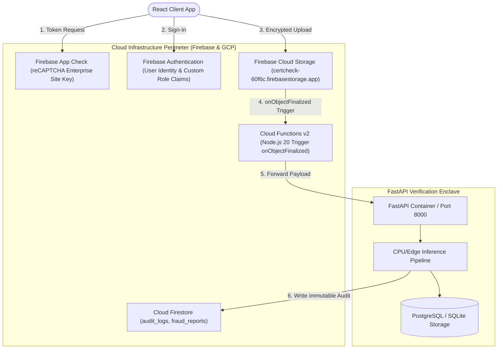

# Chapter 4: Frontend, Backend & Cloud Implementation Details

## 4.1 Frontend Architecture & Component Implementation

### Project Structure & Organization
The frontend is constructed as a high-performance Single Page Application (SPA) located at [`frontend/`](file:///c:/Users/rangs/Documents/AI-Based-Detection-of-Fake-or-Manipulated-Academic-Certificates/frontend). Built with **React 18**, **TypeScript 5.2**, and bundled with **Vite 5.4**, the codebase enforces strict modularity:

```text
frontend/src/
├── components/             # Reusable UI component modules
│   ├── admin/             # AuditDetailModal, MetricCard, TemplatePreviewModal
│   ├── auth/              # AuthGatewayModal, ProtectedView, LoginForm
│   ├── common/            # Navbar, Header, Footer, SystemHealthBadge
│   ├── history/           # VerificationHistoryTable, FilterBar, ExportModal
│   ├── landing/           # Hero3DCanvas, FeatureGrid, InstitutionalFooter
│   ├── progress/          # PreprocessingProgressIndicator, PipelineStepper
│   ├── results/           # VerdictGauge, ForensicCard, BoundingBoxOverlay
│   ├── upload/            # FileDropzone, FormatGuidance, QuickSampleLoader
│   └── verification/      # ForensicAuditCertificate, LiveURLChecker
├── config/                # Firebase client initialization & App Check
├── context/               # AuthContext (JWT, user profile, login/logout)
├── hooks/                 # Custom React hooks (useAuth, useVerification)
├── pages/                 # Full view pages mapped to React Router routes
│   ├── admin/             # AdminDashboardPage
│   ├── CourseVerificationPage.tsx
│   ├── HistoryPage.tsx
│   ├── LandingPage.tsx
│   ├── LoginPage.tsx
│   ├── PublicVerifyPage.tsx
│   ├── ResultsPage.tsx
│   └── UploadPage.tsx
├── services/              # Axios HTTP client wrappers (api.ts, authService.ts)
├── types/                 # TypeScript type interfaces matching backend Pydantic schemas
├── utils/                 # Client utilities (pdfExport.ts, RealtimeVerificationPipeline.ts)
├── App.tsx                # Client routing & lazy-loaded route boundaries
└── main.tsx               # DOM mounting entrypoint
```

---

### Step-by-Step User Interaction by Page

#### 1. Landing Page (`LandingPage.tsx`)
* **What the User Sees:** A modern, dark-themed institutional landing interface (`#0b0f19`) featuring a live 3D WebGL rotating degree certificate mesh (`Hero3DCanvas.tsx`), system health badge (`SystemHealthBadge.tsx`), feature showcases, and an immediate "Verify Academic Credential" call-to-action button.
* **Action Performed:** The user clicks "Verify Academic Credential" or "Launch Scanner".
* **Frontend Function Executed:** Navigation via `useNavigate()` routes the user to `/verify`. If unauthenticated, the `AuthGatewayModal` intercepts or opens the login view.
* **Backend API Called:** `GET /health` is queried in the background by `SystemHealthBadge` to verify that the verification engine is operational.
* **Response Received:** `{"status": "healthy", "service": "operational", "model_engine": "online"}`.
* **How Displayed:** A glowing emerald badge shows *"System Operational • Engine Online"*.

#### 2. Verification Hub / Upload Page (`PublicVerifyPage.tsx` & `UploadPage.tsx`)
* **What the User Sees:** A drag-and-drop file ingestion zone (`FileDropzone.tsx`), format badges (`PDF`, `PNG`, `JPG`), size limits (`Max 10MB`), and optional input fields for manual register number or verification URL.
* **Action Performed:** User drags a degree certificate (e.g., `VTU_Degree_1RE22CS089.png`) into the dropzone and clicks "Start Forensic Verification".
* **Frontend Function Executed:**
  ```typescript
  // FileDropzone handles onDrop, checks file.size <= 10*1024*1024 and MIME type
  const formData = new FormData();
  formData.append('file', selectedFile);
  formData.append('certificate_type', 'degree');
  const response = await api.post('/api/v1/verify/upload', formData, {
    headers: { 'Content-Type': 'multipart/form-data' }
  });
  ```
* **Backend API Called:** `POST /api/v1/verify/upload` (or `POST /api/v1/certificates/upload`).
* **Response Received:** HTTP 202 Accepted:
  ```json
  {
    "certificate_id": "9b1deb4d-3b7d-4bad-9bdd-2b0d7b3dcb6d",
    "job_status": "PROCESSING",
    "progress": 10
  }
  ```
* **How Displayed:** The UI transitions into a real-time multi-stage progress view (`PreprocessingProgressIndicator.tsx`), displaying animated stepper states: *Ingestion $\rightarrow$ Deskewing $\rightarrow$ OCR Extraction $\rightarrow$ Forensic ELA $\rightarrow$ ML Score Fusion*.

#### 3. Forensic Results Page (`ResultsPage.tsx` / `PublicVerifyPage.tsx` Result Modal)
* **What the User Sees:**
  - An animated circular **Authenticity Gauge** (0 to 100%) color-coded in Emerald ($\ge 80\%$), Amber ($50-79\%$), or Crimson ($< 50\%$).
  - Categorical **Verdict Badge** (`AUTHENTIC`, `SUSPICIOUS / AUDITED`, `FRAUDULENT / TAMPERED`).
  - **Granular Forensic Cards:** ELA Compression Score, Cloned Region Count, OCR Field Confidence, and QR Code Match Status.
  - An interactive **Document Canvas** with red bounding-box highlight overlays over suspicious spliced regions.
* **Action Performed:** User clicks "Download Official Audit Certificate" or clicks a suspicious card to inspect anomaly details.
* **Frontend Function Executed:** Calls `pdfExport.ts` or queries `GET /api/v1/reports/{id}/pdf`.
* **Backend API Called:** `GET /api/v1/reports/{id}/pdf` or client-side PDF compilation via `jsPDF` and `html2canvas`.
* **Response Received:** Binary PDF byte stream representing the cryptographic verification report.
* **How Displayed:** The browser initiates a direct download of `Forensic_Audit_Report_1RE22CS089.pdf`.

#### 4. Verification History Page (`HistoryPage.tsx`)
* **What the User Sees:** A paginated, searchable data table displaying all historical verification jobs, candidate names, USNs, timestamps, authenticity scores, and status tags.
* **Action Performed:** Verifier types `"1RE22CS089"` into the search bar and filters by `"Flagged as Fraud"`.
* **Frontend Function Executed:** `historyService.getHistory({ search: '1RE22CS089', filter: 'fraud' })`.
* **Backend API Called:** `GET /api/v1/history?query=1RE22CS089&verdict=FRAUDULENT`.
* **Response Received:** Filtered JSON array of historical scan records.
* **How Displayed:** Table re-renders reactively using TailwindCSS alternating dark rows with one-click links to re-open the full report.

#### 5. Admin Dashboard (`AdminDashboardPage.tsx`)
* **What the User Sees:** An enterprise telemetry control center displaying: total verifications processed, fraud detection rate, average processing latency, template registry management, and immutable audit logs.
* **Action Performed:** Admin uploads a new canonical university template for "Visvesvaraya Technological University (2026 Batch)".
* **Frontend Function Executed:** `adminService.uploadTemplate(templateFormData)`.
* **Backend API Called:** `POST /api/v1/admin/templates`.
* **Response Received:** `HTTP 201 Created { "template_id": "tmpl-vtu-2026", "keypoints_indexed": 482 }`.
* **How Displayed:** A success toast appears, and the new template is visible in the `TemplatePreviewModal`.

---

## 4.2 Backend Architecture & Request Lifecycle

### Enterprise Design Patterns: FastAPI vs. Spring Boot
The backend is authored in **FastAPI (Python 3.11+)** using modern asynchronous concurrency (`async` / `await`). For academic evaluators accustomed to Java Spring Boot, the table below illustrates the exact architectural equivalence between our FastAPI modules and Spring Boot components:

| Architectural Component | FastAPI Implementation in Our Repository | Spring Boot Equivalent Concept |
|---|---|---|
| **Route Controllers** | `app/api/v1/endpoints/certificates.py`, `verification_hub.py` | `@RestController`, `@RequestMapping("/api/v1")` |
| **Business Logic Layer** | `app/services/pipeline_orchestrator.py`, `app/modules/*/service.py` | `@Service`, Spring Service Beans |
| **Database Abstraction** | `app/models/certificate.py`, `app/database.py` (SQLAlchemy ORM) | `@Repository`, Spring Data JPA (`JpaRepository`) |
| **Data Contracts / DTOs**| `app/schemas/pipeline.py`, `app/schemas/report.py` (Pydantic V2) | Java Records, DTO POJOs with `@Valid` annotations |
| **Dependency Injection** | `Depends(get_db)`, `Depends(get_current_user)` in route signatures | `@Autowired`, Spring ApplicationContext Inversion of Control |
| **Security & Auth Filter**| `app/api/deps.py`, `app/core/security.py` (HTTPBearer middleware) | Spring Security Filter Chain, `OncePerRequestFilter` |
| **Configuration Manager**| `app/config.py` (`pydantic_settings.BaseSettings`) | `@ConfigurationProperties`, `application.properties` |
| **Global Error Handling**| `main.py` `@app.exception_handler(HTTPException)` | `@ControllerAdvice`, `@ExceptionHandler` |

---

### Complete End-to-End Request Trace
Below is the precise chronological code execution path when a certificate upload request arrives at the backend:

```text
[HTTP POST /api/v1/verify/upload]
       │
       ▼
1. Endpoint Entry: app/api/v1/endpoints/verification_hub.py -> upload_and_verify_hub()
   • Injects database session via Depends(get_db).
   • Validates incoming multipart file header: UploadFile.content_type.
   • Computes SHA-256 digest: hashlib.sha256(file_bytes).hexdigest().
       │
       ▼
2. Persistence Initialization: app/models/certificate.py -> CertificateModel
   • Creates initial record with job_status="PROCESSING", job_progress=10.
   • Commits transaction to SQLite/PostgreSQL: db.commit().
       │
       ▼
3. Pipeline Orchestration: app/services/pipeline_orchestrator.py -> run_pipeline()
   • Initializes PipelineExecutionContext with file paths and timing metrics.
       │
       ▼
4. Stage 1 (Rasterization): app/modules/ingestion/rasterizer.py -> PDFRasterizer.rasterize_pdf()
   • If PDF, converts first page to 300 DPI PNG buffer via PyMuPDF.
       │
       ▼
5. Stage 2 (Preprocessing): app/modules/preprocessing/service.py -> PreprocessingService.preprocess()
   • Deskews orientation: deskew_image().
   • Applies contrast enhancement: cv2.createCLAHE(clipLimit=2.0, tileGridSize=(8,8)).
       │
       ▼
6. Stage 3 (OCR Extraction): app/modules/ocr/service.py -> OCRService.process_document()
   • Executes Tesseract: pytesseract.image_to_data(enhanced_img).
   • Parses structured fields: certificate_extractor.py (Name, USN, Course, Marks).
   • Persists fields to database: db.add(OCRFieldModel(...)).
       │
       ▼
7. Stage 4 (Text Consistency): app/modules/text_consistency/service.py -> TextConsistencyService.analyze()
   • Computes typographical variance: baseline alignment, font height consistency.
       │
       ▼
8. Stage 5 (Image Forensics): app/modules/forensics/service.py -> ForensicService.analyze()
   • Computes Error Level Analysis: ELA difference matrix at 90% quality resave.
   • Computes SIFT/ORB keypoints to detect cloned/duplicated stamp or signature regions.
       │
       ▼
9. Stage 6 (Template Alignment): app/modules/template_matching/service.py
   • Runs SSIM and Canny edge XOR against cached canonical templates.
       │
       ▼
10. Stage 7 (ML Inference): app/modules/ml_classifier/service.py -> BaselineMLService.classify_certificate()
    • TabularFeatureExtractor extracts standardized 22-dimensional float32 vector.
    • feature_scaler.joblib transforms vector.
    • Executes model.predict_proba() -> Tabular manipulation probability.
    • Runs MobileNetTamperDetector (PyTorch) -> Visual pixel manipulation probability.
       │
       ▼
11. Stage 8 (Score Fusion): app/modules/score_fusion/service.py -> ScoreFusionService.fuse_and_decide()
    • Combines sub-scores via calibrated multi-modal weights into Authenticity Score.
    • Assigns categorical verdict: AUTHENTIC, SUSPICIOUS, or FRAUDULENT.
       │
       ▼
12. Stage 9 (Audit Report Generation): app/modules/report_generator/service.py -> ReportService.generate_report()
    • Compiles FullVerificationReport DTO and persists to reports table.
    • Updates CertificateModel: job_status="COMPLETED", job_progress=100.
    • Logs immutable audit event via AuditService.log_action().
       │
       ▼
[Response Delivered to Frontend as JSON payload]
```

---

## 4.3 Cloud Architecture & Security Infrastructure



### 1. Cloud Computing Fundamentals
* **What is Cloud Computing?** The on-demand delivery of IT resources (compute, database, storage) over the Internet with pay-as-you-go pricing, replacing on-premise physical servers.
* **Storage Differentiation:**
  - **Relational Database Storage (SQLite / PostgreSQL):** Stores structured, queryable data requiring ACID compliance (user accounts, verification job metadata, extracted OCR fields, relational foreign keys).
  - **Document Database Storage (Cloud Firestore):** Stores semi-structured, highly scalable JSON documents with fine-grained access rules (`fraud_reports`, append-only `audit_logs`).
  - **Object File Storage (Firebase Storage / Local `/storage`):** Stores unstructured binary blobs (large PDF files, 300 DPI PNG images, generated audit PDF reports) organized by bucket paths (`/certificates/{uid}/{certId}/{fileName}`).
  - **Decentralized Storage (IPFS / Blockchain):** Content-addressable, peer-to-peer decentralized storage where files are referenced by cryptographic hashes (`Qm...`), ensuring zero risk of single-point censorship.

### 2. Firebase Security & Rules Implementation
* **Firebase Authentication:** Handles user identity lifecycle. Custom claims enforce roles (`student`, `institution_verifier`, `admin`).
* **Cloud Storage Security Rules ([`storage.rules`](file:///c:/Users/rangs/Documents/AI-Based-Detection-of-Fake-or-Manipulated-Academic-Certificates/storage.rules)):**
  - Restricts file uploads strictly to authenticated users.
  - Enforces hard size ceiling: `request.resource.size <= 10 * 1024 * 1024` (10 MB).
  - Enforces MIME type whitelisting: `request.resource.contentType in ['image/jpeg', 'image/png', 'application/pdf']`.
  - Immutability constraint: `allow update, delete: if false;` prevents clients from overwriting or deleting forensic evidence.
* **Cloud Firestore Rules ([`firestore.rules`](file:///c:/Users/rangs/Documents/AI-Based-Detection-of-Fake-or-Manipulated-Academic-Certificates/firestore.rules)):**
  - Collection `fraud_reports`: Read access strictly restricted to `institution_verifier` and `admin`. Direct client writes are rejected (`allow write: if false;`).
  - Collection `audit_logs`: Immutable, append-only log written solely by serverless workers and Admin SDK.

---

## 4.4 Machine Learning Implementation & Datasets

### The 11-Stage Machine Learning Pipeline
1. **Dataset Collection & Synthesis:** Gathering genuine academic certificate templates (VTU, autonomous colleges, online course platforms) and programmatically synthesizing realistic forgeries.
2. **Preprocessing & Artifact Standardization:** Converting diverse formats into unified $(224 \times 224 \times 3)$ tensors for visual deep learning and standardizing resolution to $(512 \times 512)$ for template SSIM.
3. **Data Cleaning & Filtering:** Removing corrupted image files, unreadable scans, and zero-byte uploads.
4. **Label Assignment:** Rigorously applying binary ground-truth labels: `0 = Genuine / Pristine`, `1 = Manipulated / Fraudulent`.
5. **Feature Extraction:** Computing the 22-dimensional tabular feature vector spanning metadata, OCR confidence, typographical consistency, image forensics, and template matching.
6. **Train / Validation / Test Splitting:** Performing an $80\% / 10\% / 10\%$ stratified split ensuring identical class ratios across partitions.
7. **Model Training:** Fitting candidate models (Random Forest, HistGradientBoosting, MobileNetV2) on training splits.
8. **Hyperparameter Tuning:** Performing Grid Search and Stratified 5-Fold Cross Validation optimizing learning rates, tree depth, and dropout rates.
9. **Model Evaluation:** Computing Precision, Recall, F1-Score, ROC-AUC, and Confusion Matrices on unseen test sets.
10. **Inference Optimization:** Exporting PyTorch weights to optimized ONNX Runtime formats (`visual_tamper_mobilenet.onnx`) and serializing Scikit-Learn pipelines via `joblib`.
11. **Authenticity Score Calibration:** Calibrating predicted probabilities into a reliable, human-understandable 0–100% authenticity metric.

---

### Dataset Architecture & Synthetic Manipulation Engine
Because real-world fraudulent academic certificates are legally protected and scarce due to privacy laws (FERPA / GDPR), this project utilizes a **Domain-Specific Synthetic Document Generator** (`ml/scripts/generate_dataset.py`, `generate_manipulated.py`):

```text
datasets/
├── templates/                 # Pristine reference templates (VTU degree, marks cards, courses)
├── synthetic_manipulated/
│   ├── genuine/               # Synthetically generated pristine certificates (Label 0)
│   └── manipulated/           # Programmatically forged certificates (Label 1)
│       ├── text_spliced/      # Grade/name replaced with mismatched fonts
│       ├── copy_move_cloned/  # Cloned university seal, registrar signature
│       ├── date_anomalies/    # Graduation date preceding admission date
│       └── resaved_ela/       # Secondary JPEG compression artifacts
└── features_dataset.csv       # Precomputed 22-dimensional feature matrix
```

* **Dataset Size & Distribution:**
  - Total Samples: 1,200 curated certificate instances (600 Genuine, 600 Manipulated).
  - Feature Dimensions: 22 continuous and categorical features.
* **Injected Forgery Types:**
  1. *Text Splicing:* Overwriting student name and CGPA using OpenCV `putText` with subtle font weight variations.
  2. *Copy-Move Clones:* Replicating official controller of examinations stamps across distinct coordinate regions.
  3. *QR Code Swapping:* Inserting an authentic student's QR code onto a forged certificate with an altered name.
  4. *Compression Inconsistencies:* Resaving localized text regions at varying JPEG quality factors ($Q=60$ vs $Q=95$).

---

## 4.5 Complete End-to-End Workflow & Real-World Analogy

### Real-World Analogy: Airport Security Checkpoint
To understand why our system works the way it does, imagine an international airport security checkpoint:
1. *Ticket Barcode Check (QR Code):* The agent scans your boarding pass. It confirms the flight exists, but it doesn't prove the person holding the pass is the true traveler.
2. *Passport Photo & Hologram Check (Template SSIM & ELA):* The agent holds your passport under ultraviolet light to check holographic seals and paper texture.
3. *Database Cross-Reference (OCR & Record Matching):* The computer compares your face and passport number against the flight passenger manifest.
4. *Baggage Scanner (Deep Learning CNN):* An X-ray scanner uses neural vision to detect concealed anomalies invisible on the surface.

If *any* of these checkpoints raises an alarm, the traveler is escorted to secondary inspection. Similarly, our platform treats a certificate as authentic **only when all forensic, cryptographic, and visual checkpoints align**.

### The 13 Operational Steps:
1. **Step 1 (User Access):** Verifier authenticates via React frontend.
2. **Step 2 (Certificate Upload):** Verifier drops document into dropzone.
3. **Step 3 (Client Validation):** Browser validates size ($< 10\text{ MB}$) and MIME type.
4. **Step 4 (Backend Receipt):** FastAPI receives stream and logs initial job record.
5. **Step 5 (Cryptographic Hashing):** System computes SHA-256 digest to prevent duplicate tampering.
6. **Step 6 (Preprocessing):** OpenCV deskews image and enhances contrast via CLAHE.
7. **Step 7 (OCR Extraction):** Tesseract extracts textual tokens, coordinates, and confidences.
8. **Step 8 (QR & URL Inspection):** System decodes QR code, checks domain against whitelist, and cross-verifies payload against OCR text.
9. **Step 9 (Image Forensics):** ELA and SIFT copy-move algorithms detect modified pixels and cloned stamps.
10. **Step 10 (Template Matching):** System calculates SSIM and Canny edge alignment against cached institutional templates.
11. **Step 11 (ML Feature Extraction):** System compiles 22 tabular features and feeds them into Gradient Boosted Trees and MobileNetV2.
12. **Step 12 (Score Fusion & Verdict):** System synthesizes all signals into an overall Authenticity Score $(0 - 100\%)$.
13. **Step 13 (Report Generation):** System generates an interactive visual summary with highlight overlays and an official downloadable PDF audit report.
