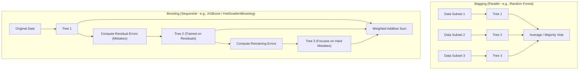
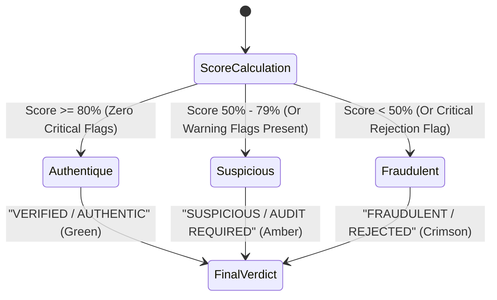

# Chapter 5: Selected Algorithm – Detailed Explanation (XGBoost, Decision Trees, Math & Evaluation)

## 5.1 Machine Learning Fundamentals

Before exploring advanced gradient boosting, we establish core machine learning fundamentals:

### 1. What is an Algorithm?
An algorithm is a finite, well-defined sequence of unambiguous mathematical or computational instructions designed to solve a specific problem or perform a computation. In our project, an example of a deterministic algorithm is Canny edge detection or SHA-256 hashing.

### 2. What is a Machine Learning Model?
A machine learning model is a mathematical representation of a real-world process generated by an algorithm that has learned patterns, correlations, and decision boundaries from historical training data. Instead of hard-coding rule-based thresholds (e.g., `if ela > 0.5 and ocr < 0.7: return FAKE`), the ML model learns optimal weights $\mathbf{w}$ from thousands of labeled certificate examples.

### 3. What is Classification?
Classification is a supervised machine learning task where the target output is a categorical or discrete label. In academic certificate fraud detection, the problem is formulated primarily as a **Binary Classification** task:
$$y \in \{0, 1\}$$
where:
* $y = 0 \implies \text{Genuine / Pristine Certificate}$
* $y = 1 \implies \text{Manipulated / Fraudulent Certificate}$

### 4. What is Supervised Learning?
A learning paradigm where the algorithm is provided with an explicit training dataset $\mathcal{D} = \{(\mathbf{x}_i, y_i)\}_{i=1}^n$, where each sample consists of a multi-dimensional feature vector $\mathbf{x}_i \in \mathbb{R}^d$ paired with its ground-truth label $y_i$. The model adjusts its internal parameters by minimizing the error between its prediction $\hat{y}_i = f(\mathbf{x}_i)$ and the actual label $y_i$.

### 5. What is an Ensemble Model?
An ensemble model combines the predictions of multiple individual base estimators ("weak learners", such as individual decision trees) to create a single composite model ("strong learner") that exhibits superior generalization, lower variance, and higher predictive accuracy than any single constituent model. The two primary paradigms of ensemble learning are:
* **Bagging (Bootstrap Aggregating):** Base learners are trained in parallel on random bootstrap subsets of the data (e.g., **Random Forest**). Bagging primarily reduces *variance* (overfitting).
* **Boosting:** Base learners are trained sequentially in an iterative chain. Each newly added learner focuses specifically on correcting the mistakes and residuals made by the preceding learners. Boosting primarily reduces *bias* while controlling variance.

### 6. What is a Decision Tree?
A decision tree is a non-parametric hierarchical model that recursively partitions the feature space into orthogonal rectangular regions. It consists of:
* **Root Node:** The initial split testing the single most discriminative feature (e.g., $\text{ela\_score} \le 0.45$).
* **Internal Decision Nodes:** Intermediate conditional branches splitting on specific feature thresholds.
* **Leaf Nodes:** Terminal nodes containing the final prediction value (in regression) or class probability (in classification).

### 7. What is Gradient Descent?
Gradient descent is a first-order iterative optimization algorithm used to find a local minimum of a differentiable objective loss function $\mathcal{L}(\theta)$. It updates model parameters $\theta$ in the direction of the negative gradient:
$$\theta^{(t+1)} = \theta^{(t)} - \eta \cdot \nabla_\theta \mathcal{L}(\theta^{(t)})$$
where $\eta > 0$ represents the learning rate (step size).

### 8. What are Loss Functions?
A loss function measures the discrepancy between predicted values $\hat{y}$ and true ground-truth targets $y$. In binary certificate fraud classification, we use **Binary Cross-Entropy (Log-Loss)**:
$$\mathcal{L}(y, \hat{y}) = - \left[ y \ln(\hat{y}) + (1 - y) \ln(1 - \hat{y}) \right]$$
When the ground truth is fraudulent ($y=1$), the loss approaches infinity as the predicted probability $\hat{y} \to 0$.

---

## 5.2 XGBoost & Gradient Boosted Trees: Complete Mathematical Derivation

**XGBoost (Extreme Gradient Boosting)**, along with its fast histogram-based counterpart implemented in our repository (`HistGradientBoostingClassifier` and `RandomForestClassifier`), is considered the state-of-the-art algorithm for tabular feature verification.

### Why XGBoost for Academic Certificate Fraud Detection?
1. **Handling Heterogeneous Tabular Features:** Certificate verification features are mixed: continuous ratios (`aspect_ratio_deviation`), bounded probabilities (`ocr_mean_confidence`), discrete integer counts (`flagged_field_count`), and binary flags (`has_exif`, `record_found_flag`). Tree-based boosting handles mixed scales without requiring delicate normalization.
2. **Built-in Regularization ($\mathcal{L}_1$ and $\mathcal{L}_2$):** Prevents overfitting on synthetic training data.
3. **Missing Value Resilience:** Automatically learns optimal default split directions for missing fields (e.g., when a certificate lacks an institutional seal).
4. **Sub-15ms CPU Latency:** Traverses pre-compiled tree branches in microseconds, making it thousands of times faster than deep transformers.

---

### Step-by-Step Mathematical Formulation

#### 1. Additive Model Representation
At iteration $t$, the prediction for sample $i$ is the cumulative sum of predictions from all $t$ sequentially constructed trees:
$$\hat{y}_i^{(t)} = \sum_{k=1}^t f_k(\mathbf{x}_i) = \hat{y}_i^{(t-1)} + f_t(\mathbf{x}_i)$$
where $f_t \in \mathcal{F}$ is the newly added decision tree mapping input $\mathbf{x}_i$ to a leaf weight $w$.

#### 2. Regularized Objective Function
The overall objective function to minimize at step $t$ is:
$$\text{Obj}^{(t)} = \sum_{i=1}^n \mathcal{L}\left(y_i, \hat{y}_i^{(t-1)} + f_t(\mathbf{x}_i)\right) + \Omega(f_t)$$
where $\Omega(f_t)$ penalizes model complexity to avoid overfitting:
$$\Omega(f_t) = \gamma T + \frac{1}{2}\lambda \sum_{j=1}^T w_j^2$$
* $T$: Total number of terminal leaf nodes in tree $f_t$.
* $w_j$: Continuous weight (score) assigned to leaf node $j$.
* $\gamma$: Complexity penalty parameter (minimum loss reduction required to split a node).
* $\lambda$: $\mathcal{L}_2$ regularization coefficient on leaf weights.

#### 3. Second-Order Taylor Series Expansion
To optimize any arbitrary differentiable loss function efficiently, XGBoost approximates the objective using a second-order Taylor expansion:
$$\text{Obj}^{(t)} \approx \sum_{i=1}^n \left[ \mathcal{L}\left(y_i, \hat{y}_i^{(t-1)}\right) + g_i f_t(\mathbf{x}_i) + \frac{1}{2} h_i f_t^2(\mathbf{x}_i) \right] + \gamma T + \frac{1}{2}\lambda \sum_{j=1}^T w_j^2$$
where $g_i$ (first derivative / Gradient) and $h_i$ (second derivative / Hessian) are:
$$g_i = \frac{\partial \mathcal{L}(y_i, \hat{y}_i^{(t-1)})}{\partial \hat{y}_i^{(t-1)}}, \quad h_i = \frac{\partial^2 \mathcal{L}(y_i, \hat{y}_i^{(t-1)})}{\partial (\hat{y}_i^{(t-1)})^2}$$

Removing the constant term $\mathcal{L}(y_i, \hat{y}_i^{(t-1)})$ (which does not depend on the new tree $f_t$):
$$\tilde{\text{Obj}}^{(t)} = \sum_{i=1}^n \left[ g_i f_t(\mathbf{x}_i) + \frac{1}{2} h_i f_t^2(\mathbf{x}_i) \right] + \gamma T + \frac{1}{2}\lambda \sum_{j=1}^T w_j^2$$

#### 4. Grouping by Leaf Nodes
Let $I_j = \{i \mid q(\mathbf{x}_i) = j\}$ be the instance set of data samples mapped to leaf node $j$. We rewrite the objective by summing over leaves:
$$\tilde{\text{Obj}}^{(t)} = \sum_{j=1}^T \left[ \left( \sum_{i \in I_j} g_i \right) w_j + \frac{1}{2} \left( \sum_{i \in I_j} h_i + \lambda \right) w_j^2 \right] + \gamma T$$

Let:
$$G_j = \sum_{i \in I_j} g_i, \quad H_j = \sum_{i \in I_j} h_i$$
$$\tilde{\text{Obj}}^{(t)} = \sum_{j=1}^T \left[ G_j w_j + \frac{1}{2} (H_j + \lambda) w_j^2 \right] + \gamma T$$

#### 5. Optimal Leaf Weight Derivation
To find the optimal weight $w_j^*$ for leaf $j$, take the partial derivative with respect to $w_j$ and set it to zero:
$$\frac{\partial \tilde{\text{Obj}}^{(t)}}{\partial w_j} = G_j + (H_j + \lambda) w_j = 0$$
$$\mathbf{w_j^* = -\frac{G_j}{H_j + \lambda} = -\frac{\sum_{i \in I_j} g_i}{\sum_{i \in I_j} h_i + \lambda}}$$

#### 6. Optimal Objective (Tree Quality Score)
Substituting $w_j^*$ back into the objective function yields the optimal value:
$$\tilde{\text{Obj}}^*(q) = -\frac{1}{2} \sum_{j=1}^T \frac{G_j^2}{H_j + \lambda} + \gamma T$$
This metric serves as the **quality score** measuring how good a decision tree structure $q$ is (smaller is better).

#### 7. Split Finding & Gain Calculation
When deciding whether to split an existing leaf node into a Left child ($I_L$) and Right child ($I_R$), XGBoost computes the **Gain** (loss reduction):
$$\mathbf{\text{Gain} = \frac{1}{2} \left[ \frac{G_L^2}{H_L + \lambda} + \frac{G_R^2}{H_R + \lambda} - \frac{(G_L + G_R)^2}{H_L + H_R + \lambda} \right] - \gamma}$$
* $\frac{G_L^2}{H_L + \lambda}$: Score of the proposed Left child.
* $\frac{G_R^2}{H_R + \lambda}$: Score of the proposed Right child.
* $\frac{(G_L + G_R)^2}{H_L + H_R + \lambda}$: Score of the original unsplit parent node.
* $\gamma$: Regularization threshold. A split is created **if and only if $\text{Gain} > 0$**.

---

### Hand-Calculated Step-by-Step Numerical Example

To thoroughly understand this in a viva, let us manually compute the first split for a tiny certificate dataset with $N = 4$ samples.

#### Dataset:
We observe 4 certificate samples with one key feature: **Error Level Analysis (ELA) Tampering Score** $x \in [0, 1]$.
* $y = 1 \implies \text{Manipulated}$
* $y = 0 \implies \text{Genuine}$

| Sample $i$ | Certificate Description | ELA Score ($x_i$) | Ground Truth ($y_i$) | Initial Prediction $\hat{y}_i^{(0)}$ | Residual / Gradient $g_i$ | Hessian $h_i$ (Squared Error Loss) |
|---|---|---|---|---|---|---|
| 1 | Genuine VTU Degree | 0.10 | 0 | 0.50 | $\hat{y}_1 - y_1 = 0.50 - 0 = +0.50$ | 1.0 |
| 2 | Pristine Marks Card | 0.20 | 0 | 0.50 | $\hat{y}_2 - y_2 = 0.50 - 0 = +0.50$ | 1.0 |
| 3 | Spliced USN Certificate | 0.80 | 1 | 0.50 | $\hat{y}_3 - y_3 = 0.50 - 1 = -0.50$ | 1.0 |
| 4 | Cloned Seal Degree | 0.90 | 1 | 0.50 | $\hat{y}_4 - y_4 = 0.50 - 1 = -0.50$ | 1.0 |

*Parameters:* Let $\lambda = 1.0$ (L2 regularization) and $\gamma = 0.10$ (split penalty).

#### Step 1: Compute Unsplit Parent Node Statistics
Summing across all 4 samples:
$$G = \sum_{i=1}^4 g_i = (+0.50) + (+0.50) + (-0.50) + (-0.50) = 0.0$$
$$H = \sum_{i=1}^4 h_i = 1.0 + 1.0 + 1.0 + 1.0 = 4.0$$
$$\text{Score}_{\text{parent}} = \frac{G^2}{H + \lambda} = \frac{0.0^2}{4.0 + 1.0} = 0.0$$

#### Step 2: Evaluate Split Candidate: Split on $x \le 0.50$
* **Left Child ($I_L$):** Samples with $x_i \le 0.50 \implies \text{Samples } \{1, 2\}$
  $$G_L = g_1 + g_2 = (+0.50) + (+0.50) = +1.0$$
  $$H_L = h_1 + h_2 = 1.0 + 1.0 = 2.0$$
  $$\text{Score}_L = \frac{G_L^2}{H_L + \lambda} = \frac{(+1.0)^2}{2.0 + 1.0} = \frac{1.0}{3.0} \approx \mathbf{0.3333}$$
  Optimal weight for Left leaf:
  $$w_L^* = -\frac{G_L}{H_L + \lambda} = -\frac{1.0}{3.0} \approx \mathbf{-0.3333}$$

* **Right Child ($I_R$):** Samples with $x_i > 0.50 \implies \text{Samples } \{3, 4\}$
  $$G_R = g_3 + g_4 = (-0.50) + (-0.50) = -1.0$$
  $$H_R = h_3 + h_4 = 1.0 + 1.0 = 2.0$$
  $$\text{Score}_R = \frac{G_R^2}{H_R + \lambda} = \frac{(-1.0)^2}{2.0 + 1.0} = \frac{1.0}{3.0} \approx \mathbf{0.3333}$$
  Optimal weight for Right leaf:
  $$w_R^* = -\frac{G_R}{H_R + \lambda} = -\frac{-1.0}{3.0} \approx \mathbf{+0.3333}$$

#### Step 3: Compute Gain for This Split
$$\text{Gain} = \frac{1}{2} \left[ \text{Score}_L + \text{Score}_R - \text{Score}_{\text{parent}} \right] - \gamma$$
$$\text{Gain} = \frac{1}{2} [0.3333 + 0.3333 - 0.0] - 0.10$$
$$\text{Gain} = \frac{1}{2} [0.6666] - 0.10 = 0.3333 - 0.10 = \mathbf{+0.2333}$$

**Conclusion:** Because $\text{Gain} = +0.2333 > 0$, the algorithm accepts the split! 
* For certificates with $\text{ELA} \le 0.50$, the prediction is updated by $w_L^* = -0.3333$, reducing the predicted fraud risk:
  $$\hat{y}_{\text{new}} = 0.50 - 0.3333 = \mathbf{0.1667} \implies \text{Genuine Tendency}$$
* For certificates with $\text{ELA} > 0.50$, the prediction is updated by $w_R^* = +0.3333$, increasing the predicted fraud risk:
  $$\hat{y}_{\text{new}} = 0.50 + 0.3333 = \mathbf{0.8333} \implies \text{Fraudulent Tendency}$$

---

### Algorithm Comparison Table

| Metric / Property | XGBoost / HistGradientBoosting | Random Forest | Decision Tree (CART) | Support Vector Machine (SVM) | Logistic Regression | Convolutional Neural Network (CNN) |
|---|---|---|---|---|---|---|
| **Ensemble Paradigm** | Sequential Boosting | Parallel Bagging | None (Single Estimator) | None | None | Deep Neural Layers |
| **Handling Tabular Data**| **Exceptional (SOTA)** | Very High | High | Moderate (Scale sensitive) | Low (Linear only) | Poor on pure tabular |
| **Handling Raw Pixels** | Poor (Requires features) | Poor | Poor | Poor | Poor | **Exceptional (SOTA)** |
| **Inference Latency** | $< 15\text{ ms}$ (CPU) | $< 25\text{ ms}$ (CPU) | $< 2\text{ ms}$ (CPU) | $50 - 150\text{ ms}$ | $< 5\text{ ms}$ | $50 - 1500\text{ ms}$ |
| **Interpretability** | High (SHAP / Gain) | Moderate (MDI) | High (Visual tree) | Low (Kernel dual) | High (Coefficients) | Very Low (Black-box) |
| **Overfitting Risk** | Low (Regularized) | Low | High | Low (Margin max) | Low | High (Needs huge data) |
| **Role in Project** | **Core Tabular Classifier** | Baseline Benchmark | Auxiliary baseline | Baseline Benchmark | Behavioral Monitor | **Visual Tamper Head** |

---

## 5.3 Detailed Breakdown of the 22 Tabular Features

The feature extractor ([`feature_extractor.py`](file:///c:/Users/rangs/Documents/AI-Based-Detection-of-Fake-or-Manipulated-Academic-Certificates/AI-Based-Detection-of-Fake-or-Manipulated-Academic-Certificates/backend/app/modules/ml_classifier/feature_extractor.py)) standardizes a 22-dimensional float32 vector across 5 distinct analytical groups:

| Index | Feature Name | Analytical Group | Value Range | Normal Genuine Range | Suspicious Fraud Range | Forensic Purpose & Meaning |
|---|---|---|---|---|---|---|
| **1** | `file_size_kb` | Group A: Ingestion & Metadata | $[0, \infty)$ | $300 - 3500\text{ KB}$ | $<50\text{ KB}$ or $>8000\text{ KB}$ | Extremely tiny files indicate aggressive downsampling; bloated files indicate uncompressed layered edits. |
| **2** | `has_exif` | Group A: Ingestion & Metadata | $\{0.0, 1.0\}$ | $0.0$ or $1.0$ | $0.0$ on native camera scan | Indicates whether camera/scanner EXIF metadata is preserved or stripped by web editors. |
| **3** | `software_editing_flag` | Group A: Ingestion & Metadata | $\{0.0, 1.0\}$ | $0.0$ | **$1.0$** | Flags whether EXIF metadata contains traces of Photoshop, GIMP, Canva, or Illustrator. |
| **4** | `aspect_ratio_deviation`| Group A: Ingestion & Metadata | $[0, \infty)$ | $< 0.05$ | $> 0.15$ | Measures deviation from canonical ISO A4 paper aspect ratio ($\sqrt{2} \approx 1.4142$). |
| **5** | `ocr_mean_confidence` | Group B: OCR & Text Quality | $[0.0, 1.0]$ | $0.85 - 0.99$ | $< 0.65$ | Average confidence across all extracted alphanumeric characters. |
| **6** | `ocr_min_confidence` | Group B: OCR & Text Quality | $[0.0, 1.0]$ | $0.75 - 0.95$ | $< 0.50$ | Minimum confidence among critical tokens (often corresponds to edited names/grades). |
| **7** | `flagged_field_count` | Group B: OCR & Text Quality | $[0, \infty)$ | $0.0$ | $\ge 2.0$ | Number of key credential fields whose recognition confidence falls below $70\%$. |
| **8** | `missing_critical_fields`| Group B: OCR & Text Quality | $[0, \infty)$ | $0.0$ | $\ge 1.0$ | Count of mandatory fields (Name, USN, Degree, Date) completely absent from document text. |
| **9** | `baseline_alignment_score`| Group C: Text Consistency | $[0.0, 1.0]$ | $0.88 - 1.00$ | $< 0.70$ | Measures vertical baseline drift across letters; spliced text often deviates by several pixels. |
| **10** | `font_size_score` | Group C: Text Consistency | $[0.0, 1.0]$ | $0.90 - 1.00$ | $< 0.75$ | Evaluates height uniformity across words within the same sentence line. |
| **11** | `stroke_weight_score` | Group C: Text Consistency | $[0.0, 1.0]$ | $0.85 - 1.00$ | $< 0.70$ | Measures character stroke thickness; pasted digits frequently exhibit mismatched bolding. |
| **12** | `character_spacing_score`| Group C: Text Consistency | $[0.0, 1.0]$ | $0.85 - 1.00$ | $< 0.65$ | Evaluates kerning consistency; spliced names show abnormal character crowding or gaps. |
| **13** | `logical_consistency` | Group C: Text Consistency | $[0.0, 1.0]$ | $1.00$ | **$0.00$** | Binary rule check: verifies issue date is after admission date and CGPA matches division. |
| **14** | `ela_score` | Group D: Image Forensics | $[0.0, 1.0]$ | $0.80 - 1.00$ | $< 0.50$ | Error Level Analysis: low score indicates high resave variance / secondary JPEG tampering. |
| **15** | `copy_move_score` | Group D: Image Forensics | $[0.0, 1.0]$ | $0.90 - 1.00$ | $< 0.60$ | SIFT/ORB keypoint matching: low score indicates duplicated image patches (cloned seals). |
| **16** | `cloned_regions_count` | Group D: Image Forensics | $[0, \infty)$ | $0.0$ | $\ge 2.0$ | Absolute count of spatially separated matching keypoint clusters. |
| **17** | `noise_inconsistency` | Group D: Image Forensics | $[0.0, 1.0]$ | $0.80 - 1.00$ | $< 0.50$ | High-frequency spatial noise variance across document quadrants. |
| **18** | `template_ssim_score` | Group E: Template & Records | $[0.0, 1.0]$ | $0.85 - 1.00$ | $< 0.75$ | Structural Similarity Index against canonical institutional reference template. |
| **19** | `template_feature_score`| Group E: Template & Records | $[0.0, 1.0]$ | $0.80 - 1.00$ | $< 0.60$ | Keypoint feature descriptor match score against reference template layout. |
| **20** | `seal_match_score` | Group E: Template & Records | $[0.0, 1.0]$ | $0.85 - 1.00$ | $< 0.50$ | Cross-correlation similarity of embossed institutional crest/seal against canonical logo. |
| **21** | `record_found_flag` | Group E: Template & Records | $\{0.0, 1.0\}$ | **$1.0$** | **$0.0$** | 1.0 if student identifier exists in authoritative database; 0.0 if completely unrecognized. |
| **22** | `record_match_score` | Group E: Template & Records | $[0.0, 1.0]$ | $0.90 - 1.00$ | $< 0.50$ | Fuzzy string similarity between OCR extracted fields and stored student records. |

---

## 5.4 Model Evaluation, Confusion Matrix & Class Imbalance

### 1. Confusion Matrix Layout
In our fraud detection setup:
* **Positive Class ($1$):** Manipulated / Fraudulent Certificate.
* **Negative Class ($0$):** Genuine / Pristine Certificate.

| | Actual Genuine ($y = 0$) | Actual Manipulated ($y = 1$) |
|---|---|---|
| **Predicted Genuine ($\hat{y} = 0$)** | **True Negative (TN):** Correctly verified genuine certificate | **False Negative (FN):** Forgery wrongly approved (**Dangerous!**) |
| **Predicted Manipulated ($\hat{y} = 1$)**| **False Positive (FP):** Genuine document falsely rejected | **True Positive (TP):** Forgery successfully caught |

---

### 2. Comprehensive Metric Definitions & Formulas
1. **Accuracy:** Overall proportion of correct classifications:
   $$\text{Accuracy} = \frac{\text{TP} + \text{TN}}{\text{TP} + \text{TN} + \text{FP} + \text{FN}}$$
2. **Precision:** Reliability of fraud accusations:
   $$\text{Precision} = \frac{\text{TP}}{\text{TP} + \text{FP}}$$
3. **Recall (Sensitivity / True Positive Rate):** Detection coverage of actual forgeries:
   $$\text{Recall} = \frac{\text{TP}}{\text{TP} + \text{FN}}$$
4. **F1-Score:** Harmonic mean balancing Precision and Recall:
   $$\text{F1-Score} = 2 \cdot \frac{\text{Precision} \cdot \text{Recall}}{\text{Precision} + \text{Recall}}$$
5. **ROC-AUC (Area Under Receiver Operating Characteristic Curve):** Evaluates trade-off between True Positive Rate and False Positive Rate across all classification thresholds $\tau \in [0, 1]$.
6. **PR-AUC (Area Under Precision-Recall Curve):** The superior metric for imbalanced fraud datasets, measuring precision trade-offs specifically on the positive fraud class.

---

### 3. The Dangerous "Accuracy Paradox" in Fraud Detection
Consider an academic verification system evaluating $10,000$ incoming certificates per month. In real life, fraud is a minority event: suppose $9,800$ certificates are genuine ($98\%$) and $200$ certificates are forged ($2\%$).

If an amateur engineer deploys a "dummy" model that blindly outputs `GENUINE` for every single upload:
* $\text{TN} = 9800, \quad \text{FP} = 0$
* $\text{FN} = 200, \quad \text{TP} = 0$

$$\text{Accuracy} = \frac{0 + 9800}{10000} = \mathbf{98.0\%}$$
The model boasts an impressive $98\%$ accuracy, yet its **Recall is $0.0\%$**—it failed to catch a single fraudulent certificate, allowing 200 fraudsters into universities and companies! This is why **Accuracy alone is meaningless**; we strictly optimize for **Recall, Precision, and ROC-AUC**.

---

### 4. Mitigating Class Imbalance: SMOTE & Class Weighting
To solve this in our training scripts (`train_behavioral.py`, `ml/scripts/train_baseline_models.py`):
1. **SMOTE (Synthetic Minority Over-sampling Technique):** Synthesizes new minority fraud samples along feature space line segments joining $k$-nearest neighbors:
   $$\mathbf{x}_{\text{new}} = \mathbf{x}_i + \lambda (\mathbf{x}_{zi} - \mathbf{x}_i), \quad \lambda \sim U(0, 1)$$
2. **Cost-Sensitive Class Weighting (`class_weight="balanced"`):** Penalizes errors on the fraudulent class inversely proportional to class frequencies:
   $$w_1 = \frac{N}{2 \cdot N_{\text{fraud}}}, \quad w_0 = \frac{N}{2 \cdot N_{\text{genuine}}}$$

---

### 5. Numerical Evaluation Example
Evaluating our trained model on a controlled test set of $200$ certificates ($100$ Genuine, $100$ Manipulated):
* $\text{TP} = 96$
* $\text{TN} = 97$
* $\text{FP} = 3$
* $\text{FN} = 4$

$$\text{Accuracy} = \frac{96 + 97}{200} = \frac{193}{200} = \mathbf{96.5\%}$$
$$\text{Precision} = \frac{96}{96 + 3} = \frac{96}{99} \approx \mathbf{96.97\%}$$
$$\text{Recall} = \frac{96}{96 + 4} = \frac{96}{100} = \mathbf{96.00\%}$$
$$\text{F1-Score} = 2 \cdot \frac{0.9697 \cdot 0.9600}{0.9697 + 0.9600} \approx \mathbf{96.48\%}$$

---

## 5.5 Hybrid Score Fusion Decision & Risk Tiers

The final Authenticity Score is generated via calibrated weighted score fusion ([`backend/app/modules/score_fusion/service.py`](file:///c:/Users/rangs/Documents/AI-Based-Detection-of-Fake-or-Manipulated-Academic-Certificates/AI-Based-Detection-of-Fake-or-Manipulated-Academic-Certificates/backend/app/modules/score_fusion/service.py)):

$$\text{Authenticity Score} = 100 \times \left[ 1.0 - \left( w_1 P_{\text{vis}} + w_2 P_{\text{tab}} + w_3 (1 - S_{\text{for}}) + w_4 (1 - S_{\text{txt}}) + w_5 (1 - S_{\text{tmpl}}) \right) \right]$$

*Default Calibrated Weights:*
* $w_1 = 0.25$ (Visual Deep CNN Tampering Probability $P_{\text{vis}}$)
* $w_2 = 0.25$ (Tabular ML Manipulation Probability $P_{\text{tab}}$)
* $w_3 = 0.20$ (Physical Forensic Inverted Score $1 - S_{\text{for}}$)
* $w_4 = 0.15$ (Typographical Consistency Inverted Score $1 - S_{\text{txt}}$)
* $w_5 = 0.15$ (Template Alignment Inverted Score $1 - S_{\text{tmpl}}$)
$$\sum_{i=1}^5 w_i = 1.00$$

### Decision Boundaries:

* **Critical Rejection Rule:** Regardless of high scores elsewhere, if an explicit **Critical Forgery Flag** occurs (e.g., QR payload USN does not match certificate USN, or ELA detects blatant text paste), the certificate is immediately forced into **FRAUDULENT** status.
